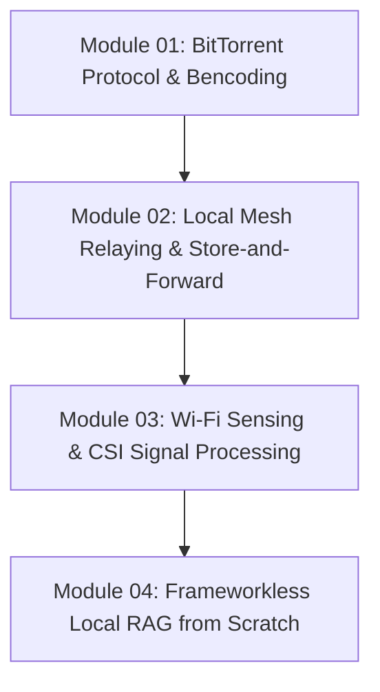

# Stage 7: Peer-to-Peer Networks, Mesh Protocols & Edge RF Sensing

> Decentralized wire protocols, zero-infrastructure offline mesh routing, radio-frequency spatial sensing, and frameworkless local AI vector retrieval.

---

## Stage Overview

In Stages 1 through 6, you mastered local-first desktop apps, air-gapped cryptographic vaults, client WebAssembly compute, real-time hardware state machines, local neural audio, and distributed ledgers.

Stage 7 takes you to the absolute frontier of sovereign systems engineering: **decentralized networks that operate without centralized servers, internet connectivity, or surveillance cameras**.

You will learn how to:
1. Parse and build decentralized binary wire protocols (BitTorrent Bencode, Kademlia DHT, and token-bucket traffic schedulers).
2. Build zero-cloud local mesh networks and delay-tolerant epidemic routing engines that communicate across Wi-Fi and Bluetooth using ephemeral ECDH cryptography.
3. Transform ambient Wi-Fi radio waves into contactless spatial radar sensors, tracking human presence and respiration through walls using Channel State Information (CSI).
4. Architect production-grade Retrieval-Augmented Generation (RAG) and dense vector search from mathematical first principles without heavy third-party frameworks.

---

## Progressive Learning Matrix

---

## Detailed Curriculum

### [01: BitTorrent Protocol, Bencoding & Swarm Bandwidth Scheduling](./01-bittorrent-protocol-and-bencoding.md)
- **Core Focus**: Wire protocol engineering, Bencode binary serialization, Kademlia DHT XOR distance metrics, BEP 6 Fast Extension, and token-bucket bandwidth limiters.
- **Hands-on Playground**: Build a zero-dependency Bencode decoder, encoder, and token-bucket bandwidth throttle in TypeScript.
- **Reference Portfolio**: *NuTorrent* (Kotlin Multiplatform desktop/mobile BitTorrent client).

### [02: Local Mesh Relaying, Ephemeral Cryptography & Store-and-Forward](./02-local-mesh-relaying-and-store-and-forward.md)
- **Core Focus**: Zero-infrastructure networking, mDNS local discovery, 1 MiB chunk streaming across OS file descriptors, ephemeral ECDH key agreement with Short Authentication String (SAS) human verification, and 5-stage epidemic synchronization handshakes (`HELLO`, `SUMMARY`, `REQUEST`, `TRANSFER`, `RELAY_ACK`).
- **Hands-on Playground**: Build a multi-node epidemic store-and-forward mesh simulator with SAS verification and SQLite pre-transmission persistence in TypeScript.
- **Reference Portfolio**: *NOVA* (high-speed local Wi-Fi sharing) and *MeshLink* (delay-tolerant BLE/Wi-Fi Direct epidemic mesh).

### [03: Wi-Fi Sensing, Channel State Information & Vital Signs DSP](./03-wifi-sensing-and-csi-signal-processing.md)
- **Core Focus**: Radio frequency physics, 64-subcarrier OFDM channel estimation, multipath propagation, phase unwrapping, circular variance, and contactless respiration bandpass filtering (0.1–0.5 Hz).
- **Hands-on Playground**: Build a Wi-Fi CSI phase unwrapper and zero-crossing BPM vital signs solver in TypeScript.
- **Reference Portfolio**: *RuView* (Wi-Fi DensePose & spatial radar intelligence).

### [04: Frameworkless Local RAG & Sovereign Semantic Search](./04-frameworkless-local-rag-from-scratch.md)
- **Core Focus**: Eliminating framework bloat, 384-dimensional dense semantic embeddings (`all-MiniLM-L6-v2`), L2 vector normalization, cosine similarity matrix dot products, defensive system prompt framing, and local Ollama Gemma 3 inference.
- **Hands-on Playground**: Build an in-memory vector database and grounded prompt synthesizer in TypeScript.
- **Reference Portfolio**: *College Recommendation & Semantic Matching System* (frameworkless tabular RAG).

---

## Stage Invariants

1. **Zero Emojis**: Every module, diagram, comment, and document adheres strictly to clean, professional engineering typography.
2. **Deterministic Wire Protocols**: Never send unversioned or unformatted binary data over raw sockets; enforce unambiguous length prefixes and checksums.
3. **Delay-Tolerant Persistence**: Persist payloads locally before dispatching to physical radios; network partitions are an expected operational state.
4. **Mathematical Verification**: Ground all vector math and signal processing in first-principles formulas rather than black-box libraries.
