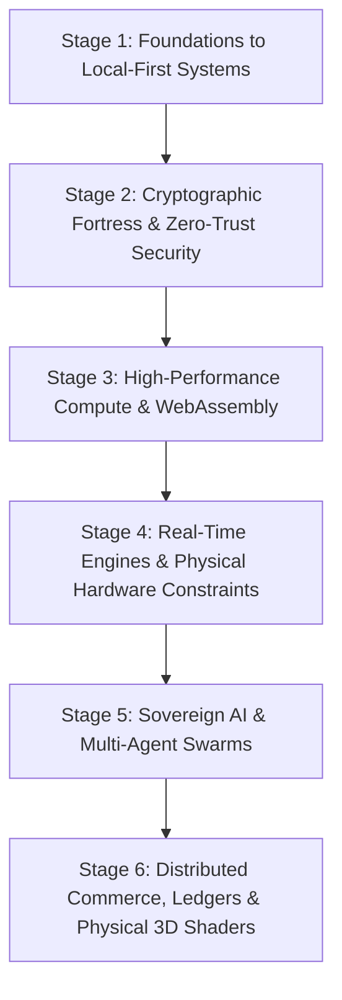

# The Sovereign Developer Learning Path

> From Initial Editor Setup to Architecting Air-Gapped Vaults, Local Neural Speech Engines, and Physical LAN Tournament Systems.

---

## Welcome to the Sovereign Learning Path

Most computer science tutorials teach syntax in isolation: how to write a `for` loop in Python, how to create a button in React, or how to spin up a generic CRUD backend that relies entirely on expensive cloud SaaS providers.

When ambitious students try to build real-world systems, they hit immediate roadblocks:
- Their apps freeze when processing large files because everything runs on the main JavaScript thread.
- Their databases suffer double-booking bugs the moment two users click "Reserve" simultaneously.
- Their mobile apps leak sensitive user credentials because they never learned how to air-gap or use hardware keystores.
- Their tournament brackets break on match day because software was written without modeling physical hardware stations.
- Their 3D web portfolios cause mobile phones to overheat within 60 seconds because of uncapped Retina resolution.

This curriculum is distilled directly from the production architectures and hard-won lessons across our software portfolio (*CodexOS*, *Kryptyx*, *ErgonPDF*, *Rheo*, *Valorant Tournament Operations*, *Parkly*, *PinkPulse*, *Calypso*, and *Zeus*).

It takes you step-by-step from beginner workstation foundations to building sovereign, resilient, high-agency software systems.

---

## The 6 Builder Stages

---

## Curriculum Navigation Matrix

### [Stage 1: Foundations to Local-First Systems](./01-foundations-to-local-first/README.md)
> *Escape the cloud lock-in trap. Learn how your operating system works, master the terminal, and build native desktop applications that own their data locally.*
- [`01-workstation-mastery-and-shell.md`](./01-foundations-to-local-first/01-workstation-mastery-and-shell.md): Keyboard-driven development, Zsh, Starship, and POSIX CLI fluency.
- [`02-local-first-data-with-sqlite.md`](./01-foundations-to-local-first/02-local-first-data-with-sqlite.md): Building zero-network offline applications with SQLite and SQLCipher (as in *Aura 3.0*).
- [`03-native-desktop-with-rust-tauri.md`](./01-foundations-to-local-first/03-native-desktop-with-rust-tauri.md): Replacing Electron with Tauri 2.0, Rust FFI, and spawning low-latency PTY terminals (as in *CodexOS*).
- [`04-virtualized-ui-rendering.md`](./01-foundations-to-local-first/04-virtualized-ui-rendering.md): Virtualizing DOM lists to render 100,000 records at 60 FPS without memory leaks.

### [Stage 2: Cryptographic Fortress & Zero-Trust Security](./02-cryptographic-fortress-and-zero-trust/README.md)
> *Protect human privacy with mathematical rigor. Build air-gapped password vaults, post-quantum cryptography, and zero-metadata messaging.*
- [`01-symmetric-encryption-and-key-derivation.md`](./02-cryptographic-fortress-and-zero-trust/01-symmetric-encryption-and-key-derivation.md): Memory-hard Argon2id key derivation, AES-256-GCM, and memory zeroization.
- [`02-air-gapped-mobile-security.md`](./02-cryptographic-fortress-and-zero-trust/02-air-gapped-mobile-security.md): Building zero-network Android apps with Jetpack Compose, hardware Keystore, and BiometricPrompt (as in *Kryptyx*).
- [`03-p2p-webrtc-and-the-double-ratchet.md`](./02-cryptographic-fortress-and-zero-trust/03-p2p-webrtc-and-the-double-ratchet.md): Ephemeral signaling, WebRTC DataChannels, Signal Protocol Double Ratchet, and BIP-39 mnemonic identities (as in *Calypso*).

### [Stage 3: High-Performance Compute & WebAssembly](./03-high-performance-compute-and-wasm/README.md)
> *Transform the browser into a high-performance sandbox. Process hundreds of thousands of records and manipulate binary files without cloud servers.*
- [`01-web-workers-and-transferable-memory.md`](./03-high-performance-compute-and-wasm/01-web-workers-and-transferable-memory.md): Overcoming the JavaScript single-thread bottleneck with Web Workers and zero-copy transferable ArrayBuffers.
- [`02-in-browser-pdf-and-binary-assembly.md`](./03-high-performance-compute-and-wasm/02-in-browser-pdf-and-binary-assembly.md): Client-side binary PDF manipulation with `pdf-lib`, WebAssembly, and Blob URL lifecycle management (as in *ErgonPDF*).

### [Stage 4: Real-Time Engines & Physical Hardware Constraints](./04-realtime-engines-and-physical-systems/README.md)
> *Bridge the gap between pure code and the physical world. Model physical hardware stations, tournament brackets, and high-concurrency esports scoring.*
- [`01-hardware-constrained-state-machines.md`](./04-realtime-engines-and-physical-systems/01-hardware-constrained-state-machines.md): Modeling physical 10-PC stations, network subnets, and venue constraints as software invariants.
- [`02-tournament-pairing-algorithms.md`](./04-realtime-engines-and-physical-systems/02-tournament-pairing-algorithms.md): The Berger Round-Robin algorithm, single elimination state machines, and pre-flight gates (as in *VALORANT Tournament Operations*).
- [`03-vectorized-scoring-and-csv-ingestion.md`](./04-realtime-engines-and-physical-systems/03-vectorized-scoring-and-csv-ingestion.md): Battle Royale 25-team multi-lobby scoring, BGIS 10-point matrices, and PapaParse CSV ingestion (as in *BGMI TCC*).

### [Stage 5: Sovereign AI & Multi-Agent Swarms](./05-sovereign-ai-and-multi-agent-swarms/README.md)
> *Move past fragile cloud API wrappers. Run local neural inference, stream PCM audio, and choreograph autonomous multi-agent systems.*
- [`01-local-neural-inference-with-pytorch.md`](./05-sovereign-ai-and-multi-agent-swarms/01-local-neural-inference-with-pytorch.md): Running local zero-shot speech synthesis with PyTorch dynamic Apple Metal / NVIDIA CUDA dispatch (as in *Rheo*).
- [`02-model-context-protocol-and-tools.md`](./05-sovereign-ai-and-multi-agent-swarms/02-model-context-protocol-and-tools.md): Standardized Model Context Protocol (MCP) tool contracts, JSON schemas, and agent execution sandboxes (as in *Skills Bot*).
- [`03-event-driven-agent-choreography.md`](./05-sovereign-ai-and-multi-agent-swarms/03-event-driven-agent-choreography.md): Asynchronous event buses, Agent A drafting vs Agent B stress-testing, and decoupled agent topologies.

### [Stage 6: Distributed Commerce, Ledgers & Physical 3D Shaders](./06-distributed-commerce-and-creative-engineering/README.md)
> *Engineer mission-critical financial systems, ethical identity verification, and 60 FPS hardware-accelerated 3D graphics.*
- [`01-concurrency-control-and-marketplaces.md`](./06-distributed-commerce-and-creative-engineering/01-concurrency-control-and-marketplaces.md): Optimistic Concurrency Control, version increment locking, and preventing double-booking under load (as in *Parkly*).
- [`02-double-entry-accounting-invariants.md`](./06-distributed-commerce-and-creative-engineering/02-double-entry-accounting-invariants.md): Double-entry ledger accounting, integer cents arithmetic, and property-based testing with `fast-check` (as in *COUNT*).
- [`03-ethical-data-and-ephemeral-identity.md`](./06-distributed-commerce-and-creative-engineering/03-ethical-data-and-ephemeral-identity.md): Client-side Gail Model oncology calculations (*PinkPulse*) and DigiLocker OAuth2 non-extractive verification (*SDA Matrimony*).
- [`04-gpu-pipelines-and-custom-glsl-shaders.md`](./06-distributed-commerce-and-creative-engineering/04-gpu-pipelines-and-custom-glsl-shaders.md): 60 FPS WebGL pipelines, custom GLSL vertex/fragment wave shaders, DPR clamping, and GPU memory disposal (as in *ZEUS*).

---

## How to Study This Curriculum

1. **Pick Your Entry Stage**: If you are a beginner, start at Stage 1. If you already have fullstack experience, jump directly to Stage 2 (Cryptography) or Stage 4 (Real-Time Systems).
2. **Build Every Playground**: Each guide includes a self-contained, compilable code playground. Do not just read the code; run it on your local machine, inspect the console outputs, and break things intentionally.
3. **Tackle the Weekend Hackathon Challenge**: Every lesson ends with a 3-tier project challenge (Core, Advanced, Hardcore). Complete at least the Core level before moving to the next module.
4. **Adhere to the Invariants**: Zero emojis, clean architecture, comprehensive type safety, and defensive engineering.
