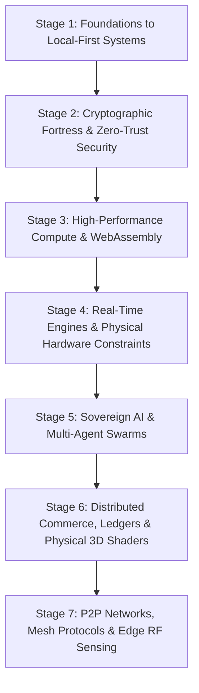

# The Sovereign Developer Learning Path

> From Initial Editor Setup to Architecting Air-Gapped Vaults, Local Neural Speech Engines, Physical LAN Tournament Systems, Decentralized BitTorrent Wire Protocols, and Wi-Fi Spatial Radar.

---

## Welcome to the Sovereign Learning Path

Most computer science tutorials teach syntax in isolation: how to write a `for` loop in Python, how to create a button in React, or how to spin up a generic CRUD backend that relies entirely on expensive cloud SaaS providers.

When ambitious students try to build real-world systems, they hit immediate roadblocks:
- Their apps freeze when processing large files because everything runs on the main JavaScript thread.
- Their databases suffer double-booking bugs the moment two users click "Reserve" simultaneously.
- Their mobile apps leak sensitive user credentials because they never learned how to air-gap or use hardware keystores.
- Their tournament brackets break on match day because software was written without modeling physical hardware stations.
- Their 3D web portfolios cause mobile phones to overheat within 60 seconds because of uncapped Retina resolution.
- Their networking breaks during emergencies or offline conditions because they never learned peer-to-peer wire protocols or store-and-forward mesh routing.

This curriculum is distilled directly from the production architectures and hard-won lessons across our software portfolio (*CodexOS*, *Kryptyx*, *ErgonPDF*, *Rheo*, *Valorant Tournament Operations*, *Parkly*, *PinkPulse*, *Calypso*, *Zeus*, *RuView*, *NuTorrent*, *NOVA*, *MeshLink*, and *College Recommendation System*).

It takes you step-by-step from beginner workstation foundations to building sovereign, resilient, high-agency software systems.

> **New to the repository?** Follow the dedicated chronological roadmap: [**The Beginner Onboarding Flow (Start Here)**](../BEGINNER_ONBOARDING_FLOW.md) for an exact 11-phase, day-by-day learning schedule. Review our certified [**Repository Quality Audit Report**](../REPOSITORY_AUDIT_REPORT.md).

---

## The 7 Builder Stages

---

## Curriculum Navigation Matrix

### [Stage 1: Foundations to Local-First Systems](./01-foundations-to-local-first/README.md)
> *Escape the cloud lock-in trap. Learn how your operating system works, master the terminal, and build native desktop applications that own their data locally.*
- [`01-workstation-mastery-and-shell.md`](./01-foundations-to-local-first/01-workstation-mastery-and-shell.md): Keyboard-driven development, Zsh, Starship, and POSIX CLI fluency.
- [`02-local-first-data-with-sqlite.md`](./01-foundations-to-local-first/02-local-first-data-with-sqlite.md): Building zero-network offline applications with SQLite and SQLCipher (Reference: [CodeSorcerer-007/Aura](https://github.com/CodeSorcerer-007/Aura)).
- [`03-native-desktop-with-rust-tauri.md`](./01-foundations-to-local-first/03-native-desktop-with-rust-tauri.md): Replacing Electron with Tauri 2.0, Rust FFI, and spawning low-latency PTY terminals (Reference: [CodeSorcerer-007/CodexOS](https://github.com/CodeSorcerer-007/CodexOS)).
- [`04-virtualized-ui-rendering.md`](./01-foundations-to-local-first/04-virtualized-ui-rendering.md): Virtualizing DOM lists to render 100,000 records at 60 FPS without memory leaks.

### [Stage 2: Cryptographic Fortress & Zero-Trust Security](./02-cryptographic-fortress-and-zero-trust/README.md)
> *Protect human privacy with mathematical rigor. Build air-gapped password vaults, post-quantum cryptography, and zero-metadata messaging.*
- [`01-symmetric-encryption-and-key-derivation.md`](./02-cryptographic-fortress-and-zero-trust/01-symmetric-encryption-and-key-derivation.md): Memory-hard Argon2id key derivation, AES-256-GCM, and memory zeroization.
- [`02-air-gapped-mobile-security.md`](./02-cryptographic-fortress-and-zero-trust/02-air-gapped-mobile-security.md): Building zero-network Android apps with Jetpack Compose, hardware Keystore, and BiometricPrompt (Reference: [CodeSorcerer-007/Kryptx](https://github.com/CodeSorcerer-007/Kryptx)).
- [`03-p2p-webrtc-and-the-double-ratchet.md`](./02-cryptographic-fortress-and-zero-trust/03-p2p-webrtc-and-the-double-ratchet.md): Ephemeral signaling, WebRTC DataChannels, Signal Protocol Double Ratchet, and BIP-39 mnemonic identities (Reference: [MasterZ1311/Ghost-Messenger](https://github.com/MasterZ1311/Ghost-Messenger)).

### [Stage 3: High-Performance Compute & WebAssembly](./03-high-performance-compute-and-wasm/README.md)
> *Transform the browser into a high-performance sandbox. Process hundreds of thousands of records and manipulate binary files without cloud servers.*
- [`01-web-workers-and-transferable-memory.md`](./03-high-performance-compute-and-wasm/01-web-workers-and-transferable-memory.md): Overcoming the JavaScript single-thread bottleneck with Web Workers and zero-copy transferable ArrayBuffers.
- [`02-in-browser-pdf-and-binary-assembly.md`](./03-high-performance-compute-and-wasm/02-in-browser-pdf-and-binary-assembly.md): Client-side binary PDF manipulation with `pdf-lib`, WebAssembly, and Blob URL lifecycle management (Reference: [CodeSorcerer-007/ErgonPDF](https://github.com/CodeSorcerer-007/ErgonPDF)).

### [Stage 4: Real-Time Engines & Physical Hardware Constraints](./04-realtime-engines-and-physical-systems/README.md)
> *Bridge the gap between pure code and the physical world. Model physical hardware stations, tournament brackets, and high-concurrency esports scoring.*
- [`01-hardware-constrained-state-machines.md`](./04-realtime-engines-and-physical-systems/01-hardware-constrained-state-machines.md): Modeling physical 10-PC stations, network subnets, and venue constraints as software invariants.
- [`02-tournament-pairing-algorithms.md`](./04-realtime-engines-and-physical-systems/02-tournament-pairing-algorithms.md): The Berger Round-Robin algorithm, single elimination state machines, and pre-flight gates (Reference: [MasterZ1311/Valorant-Tourney-Ops](https://github.com/MasterZ1311/Valorant-Tourney-Ops)).
- [`03-vectorized-scoring-and-csv-ingestion.md`](./04-realtime-engines-and-physical-systems/03-vectorized-scoring-and-csv-ingestion.md): Battle Royale 25-team multi-lobby scoring, BGIS 10-point matrices, and PapaParse CSV ingestion (Reference: [MasterZ1311/BGMI-Tourney-Ops](https://github.com/MasterZ1311/BGMI-Tourney-Ops)).

### [Stage 5: Sovereign AI & Multi-Agent Swarms](./05-sovereign-ai-and-multi-agent-swarms/README.md)
> *Move past fragile cloud API wrappers. Run local neural inference, stream PCM audio, and choreograph autonomous multi-agent systems.*
- [`01-local-neural-inference-with-pytorch.md`](./05-sovereign-ai-and-multi-agent-swarms/01-local-neural-inference-with-pytorch.md): Running local zero-shot speech synthesis with PyTorch dynamic Apple Metal / NVIDIA CUDA dispatch (Reference: [MasterZ1311/Rheo](https://github.com/MasterZ1311/Rheo)).
- [`02-model-context-protocol-and-tools.md`](./05-sovereign-ai-and-multi-agent-swarms/02-model-context-protocol-and-tools.md): Standardized Model Context Protocol (MCP) tool contracts, JSON schemas, and agent execution sandboxes (Reference: [MasterZ1311/Skills-Bot-V.-MZ.0-](https://github.com/MasterZ1311/Skills-Bot-V.-MZ.0-)).
- [`03-event-driven-agent-choreography.md`](./05-sovereign-ai-and-multi-agent-swarms/03-event-driven-agent-choreography.md): Asynchronous event buses, Agent A drafting vs Agent B stress-testing, and decoupled agent topologies.

### [Stage 6: Distributed Commerce, Ledgers & Physical 3D Shaders](./06-distributed-commerce-and-creative-engineering/README.md)
> *Engineer mission-critical financial systems, ethical identity verification, and 60 FPS hardware-accelerated 3D graphics.*
- [`01-concurrency-control-and-marketplaces.md`](./06-distributed-commerce-and-creative-engineering/01-concurrency-control-and-marketplaces.md): Optimistic Concurrency Control, version increment locking, and preventing double-booking under load (Reference: [MasterZ1311/Parkly](https://github.com/MasterZ1311/Parkly)).
- [`02-double-entry-accounting-invariants.md`](./06-distributed-commerce-and-creative-engineering/02-double-entry-accounting-invariants.md): Double-entry ledger accounting, integer cents arithmetic, and property-based testing with `fast-check` (Reference: [MasterZ1311/FinTrack-Pro](https://github.com/MasterZ1311/FinTrack-Pro)).
- [`03-ethical-data-and-ephemeral-identity.md`](./06-distributed-commerce-and-creative-engineering/03-ethical-data-and-ephemeral-identity.md): Client-side Gail Model oncology calculations (Reference: [MasterZ1311/Pink-Pulse](https://github.com/MasterZ1311/Pink-Pulse)) and DigiLocker OAuth2 non-extractive verification (Reference: [MasterZ1311/SDA-Matrimony-Site](https://github.com/MasterZ1311/SDA-Matrimony-Site)).
- [`04-gpu-pipelines-and-custom-glsl-shaders.md`](./06-distributed-commerce-and-creative-engineering/04-gpu-pipelines-and-custom-glsl-shaders.md): 60 FPS WebGL pipelines, custom GLSL vertex/fragment wave shaders, DPR clamping, and GPU memory disposal (Reference: [CodeSorcerer-007/Zeus](https://github.com/CodeSorcerer-007/Zeus)).

### [Stage 7: P2P Networks, Mesh Protocols & Edge RF Sensing](./07-p2p-mesh-and-edge-rf-sensing/README.md)
> *Decentralized wire protocols, zero-infrastructure offline mesh routing, radio-frequency spatial sensing, and frameworkless local AI vector retrieval.*
- [`01-bittorrent-protocol-and-bencoding.md`](./07-p2p-mesh-and-edge-rf-sensing/01-bittorrent-protocol-and-bencoding.md): Binary wire protocols, Bencoding serializing/deserializing, Kademlia DHT XOR distance, BEP 6 Fast Extension, and token-bucket bandwidth limiters (Reference: [MasterZ1311/NuTorrent](https://github.com/MasterZ1311/NuTorrent)).
- [`02-local-mesh-relaying-and-store-and-forward.md`](./07-p2p-mesh-and-edge-rf-sensing/02-local-mesh-relaying-and-store-and-forward.md): Zero-infrastructure networking, mDNS local discovery, streaming 1 MiB chunk pipelines, ephemeral ECDH key agreement with SAS visual pairing words, and delay-tolerant store-and-forward epidemic sync handshakes (Reference: [MasterZ1311/Dev-AURA](https://github.com/MasterZ1311/Dev-AURA)).
- [`03-wifi-sensing-and-csi-signal-processing.md`](./07-p2p-mesh-and-edge-rf-sensing/03-wifi-sensing-and-csi-signal-processing.md): Edge RF signal processing, OFDM subcarrier phase measurement, phase unwrapping, bandpass filtering, and extracting human vital signs through walls without optical cameras (Reference: [MasterZ1311/RuView](https://github.com/MasterZ1311/RuView)).
- [`04-frameworkless-local-rag-from-scratch.md`](./07-p2p-mesh-and-edge-rf-sensing/04-frameworkless-local-rag-from-scratch.md): Frameworkless semantic retrieval, 384-dimensional dense text embeddings, pure cosine similarity dot products, defensive system prompt framing, and zero-cloud local LLM synthesis with Ollama (Reference: [iamvishaal491/college_recom_colvex](https://github.com/iamvishaal491/college_recom_colvex)).

---

## Reference Source Code Attachments

To inspect the real production code while studying:

| Repository Name | Direct GitHub Link | Primary Domain / Focus |
| :--- | :--- | :--- |
| **Dev-AURA (Flagship)** | [MasterZ1311/Dev-AURA](https://github.com/MasterZ1311/Dev-AURA) | Sovereign Developer Handbook, Engineering Standards & Curriculum |
| **CodexOS** | [CodeSorcerer-007/CodexOS](https://github.com/CodeSorcerer-007/CodexOS) | Native Tauri 2.0 Desktop OS, Rust PTY terminals, Monaco Editor |
| **Aura 3.0** | [CodeSorcerer-007/Aura](https://github.com/CodeSorcerer-007/Aura) | Mindful Productivity, Tone.js acoustics, local-first Zustand |
| **Kryptyx** | [CodeSorcerer-007/Kryptx](https://github.com/CodeSorcerer-007/Kryptx) | Air-gapped Android vault, Argon2id, ML-KEM-768 lattice crypto |
| **Ghost Messenger** | [MasterZ1311/Ghost-Messenger](https://github.com/MasterZ1311/Ghost-Messenger) | WebRTC DataChannel P2P, Signal Double Ratchet, BIP-39 mnemonic IDs |
| **ErgonPDF** | [CodeSorcerer-007/ErgonPDF](https://github.com/CodeSorcerer-007/ErgonPDF) | In-browser client WASM PDF manipulation & Web Workers |
| **Rheo / VoiceBox** | [MasterZ1311/Rheo](https://github.com/MasterZ1311/Rheo) | Local PyTorch neural speech cloning & streaming PCM audio |
| **Skills Bot** | [MasterZ1311/Skills-Bot-V.-MZ.0-](https://github.com/MasterZ1311/Skills-Bot-V.-MZ.0-) | Model Context Protocol (MCP) standardized tool registry |
| **RuView** | [MasterZ1311/RuView](https://github.com/MasterZ1311/RuView) | ESP32-S3 Wi-Fi CSI spatial radar & vital sign DSP |
| **NuTorrent** | [MasterZ1311/NuTorrent](https://github.com/MasterZ1311/NuTorrent) | Pure Kotlin KMP BitTorrent v1 wire engine & Kademlia DHT |
| **Valorant Tourney Ops** | [MasterZ1311/Valorant-Tourney-Ops](https://github.com/MasterZ1311/Valorant-Tourney-Ops) | Berger Round-Robin algorithm & 10-PC physical station FSM |
| **BGMI Tourney Ops** | [MasterZ1311/BGMI-Tourney-Ops](https://github.com/MasterZ1311/BGMI-Tourney-Ops) | 25-team Battle Royale multi-lobby scoring matrix & CSV stream |
| **Parkly** | [MasterZ1311/Parkly](https://github.com/MasterZ1311/Parkly) | Optimistic Concurrency Control (OCC) marketplace booking |
| **FinTrack-Pro / COUNT** | [MasterZ1311/FinTrack-Pro](https://github.com/MasterZ1311/FinTrack-Pro) | Immutable double-entry ledger & integer cents arithmetic |
| **Pink-Pulse** | [MasterZ1311/Pink-Pulse](https://github.com/MasterZ1311/Pink-Pulse) | Client-side Gail Model oncology calculations & memory scrubber |
| **SDA-Matrimony-Site** | [MasterZ1311/SDA-Matrimony-Site](https://github.com/MasterZ1311/SDA-Matrimony-Site) | DigiLocker OAuth2 non-extractive token verification |
| **Zeus** | [CodeSorcerer-007/Zeus](https://github.com/CodeSorcerer-007/Zeus) | Three.js WebGL 60 FPS pipelines & custom GLSL wave shaders |
| **College Recom Colvex** | [iamvishaal491/college_recom_colvex](https://github.com/iamvishaal491/college_recom_colvex) | Frameworkless tabular RAG & 384-dim dense vector embeddings |
| **Omni-Campus** | [MasterZ1311/Omni-Campus](https://github.com/MasterZ1311/Omni-Campus) | Real-time campus operations & resource event coordinating |
| **SuperCalcee** | [MasterZ1311/SuperCalcee](https://github.com/MasterZ1311/SuperCalcee) | Calculator UI and state machine mathematics |
| **Vestitures** | [MasterZ1311/Vestitures](https://github.com/MasterZ1311/Vestitures) | E-commerce web architecture & product catalog workflows |
| **My Portfolio** | [MasterZ1311/My-Portfolio](https://github.com/MasterZ1311/My-Portfolio) | Sovereign developer portfolio showcasing projects and systems |

---

## How to Study This Curriculum

1. **Pick Your Entry Stage**: If you are a beginner, start at Stage 1. If you already have fullstack experience, jump directly to Stage 2 (Cryptography), Stage 4 (Real-Time Systems), or Stage 7 (P2P Networks).
2. **Build Every Playground**: Each guide includes a self-contained, compilable code playground. Do not just read the code; run it on your local machine, inspect the console outputs, and break things intentionally.
3. **Cross-Reference the Source Repositories**: Use the links above to inspect how the principles are structured in real production applications.
4. **Tackle the Weekend Hackathon Challenge**: Every lesson ends with a 3-tier project challenge (Core, Advanced, Hardcore). Complete at least the Core level before moving to the next module.
5. **Adhere to the Invariants**: Zero emojis, clean architecture, comprehensive type safety, and defensive engineering.
