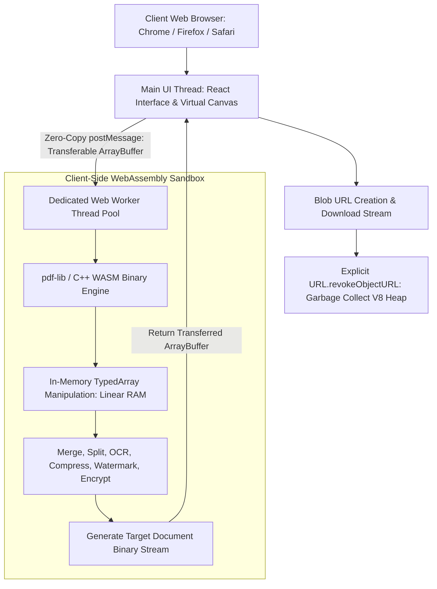

# Client-Side WebAssembly Compute Architecture

> In-browser heavy compute pipelines, client-side document processing, and zero-server infrastructure.

---

## Systems in this Domain

- [**ErgonPDF**](./ergonpdf-document-workspace.md): Complete client-side document workspace offering 20+ PDF utilities running entirely inside the browser using WebAssembly and Web Workers.

---

## Technical Architecture: In-Browser Heavy Compute Pipeline

---

## Domain Engineering Highlights

1. **Client-Side Heavy Compute**: Moving binary processing directly into the browser runtime eliminates cloud server operating costs.
2. **Main Thread Isolation**: Web Workers handle document compression, merging, and page extraction while keeping the UI responsive.
3. **Memory Safety & Blob Disposal**: Proactive deallocation of binary buffers and revocation of object URLs prevents browser heap exhaustion.
