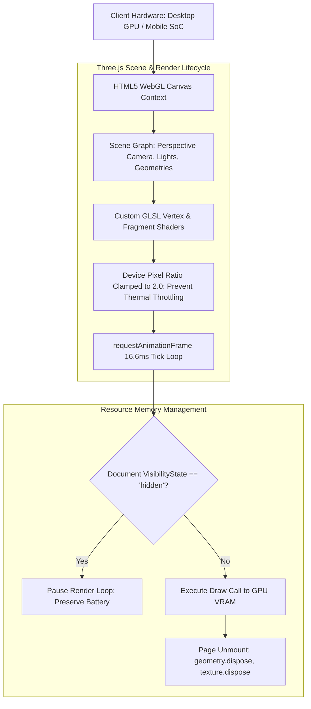

# Creative Engineering and 3D Web Architecture

> Hardware-accelerated 3D graphics, real-time shader pipelines, and visceral web micro-interactions.

---

## Systems in this Domain

- [**ZEUS & Zeus New Web**](./zeus-interactive-3d-shaders.md): High-performance interactive 3D web experiences utilizing React Three Fiber, custom WebGL shaders, and GSAP micro-animations.

---

## Technical Architecture: 60 FPS WebGL GPU Pipeline

---

## Domain Engineering Highlights

1. **60 FPS GPU Rendering**: Throttling animation loops when off-screen and optimizing geometry draw calls to maintain smooth framerates on mobile devices.
2. **Hardware & Web Integration**: Connecting web interfaces with hardware and IoT resources (`Zeus-IOT-Resources`) to bridge physical hardware with digital experiences.
3. **Shader Resource Management**: Proactive disposal of WebGL geometries, textures, and materials to avoid browser memory leaks.
