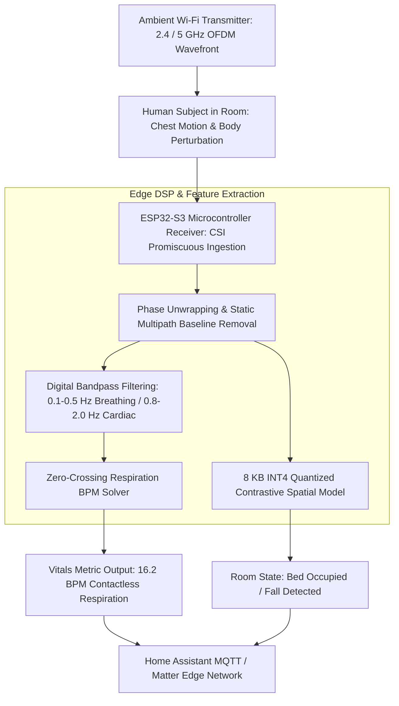

# Edge Sensing & Radio Physics Case Studies

> Contactless Spatial Intelligence, Wi-Fi Channel State Information (CSI), and Microcontroller Radar Sensing.

---

## Overview

Traditional computer vision relies on optical cameras. However, cameras fail in darkness, cannot see through walls, and introduce severe privacy violations when deployed in bedrooms or hospital wards.

This section documents our production case study in **Edge RF Sensing & Spatial Intelligence**:
- Using low-cost ESP32-S3 microcontrollers (\$9 per node) to capture Channel State Information (CSI) from existing ambient Wi-Fi waves.
- Extracting human presence, respiration rates, and heart rates through drywall without wearables or cameras.
- 4-bit quantizing neural encoders to fit within an 8 KB memory footprint on edge microcontrollers.

---

## Technical Architecture: Edge RF Spatial Sensing Pipeline

---

## Case Studies in This Category

- [`ruview-wifi-densepose.md`](./ruview-wifi-densepose.md): Spatial intelligence, through-wall presence detection, contactless vital signs extraction, and Ed25519 witness attestation.
