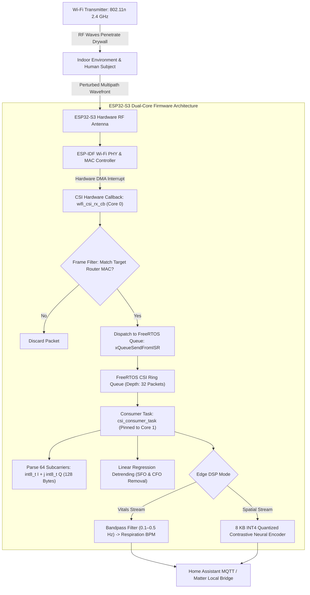

# Case Study: RuView (WiFi DensePose & Spatial Intelligence)

> Track: Project Case Studies (Edge Sensing & Radio Physics)  
> Prerequisite Knowledge: C systems programming, FreeRTOS tasks & queues, 802.11 OFDM subcarriers, digital signal processing  
> Estimated Build Time: 75 minutes  
> Target Project Outcome: Building an authentic ESP32-S3 ESP-IDF C firmware CSI collector with hardware promiscuous callback (`esp_wifi_set_csi_rx_cb`), frame filtering, DMA buffer dispatch, and FreeRTOS queueing, alongside edge vitals DSP processing

---

## 1. The Hook: Why You Need This in Your Arsenal

In healthcare monitoring, smart homes, and physical security, the standard solution has always been to install optical cameras or attach wearable sensor bands:

- **Cameras Invade Human Dignity**: Nobody wants a lens pointed at their bed or bathroom. Cameras also fail completely in pitch-black darkness, behind smoke, or through physical walls.
- **Wearable Sensors Cause Friction**: Wearable bands run out of battery, cause skin irritation, and elderly or trauma patients frequently forget or refuse to wear them.

In **RuView (π RuView)**, we unlocked an entirely new paradigm: **Seeing through walls using radio physics**.
Every Wi-Fi router continuously fills physical rooms with electromagnetic waves across 64 orthogonal frequency-division multiplexing (OFDM) subcarriers. When a person moves, walks, breathes, or sits still, their chest cavity and body tissues perturb those radio waves in subtle, mathematically measurable ways.

By capturing **Channel State Information (CSI)** on $9 ESP32-S3 microcontrollers:

- We track presence, motion, and posture through drywall and in pitch darkness.
- We measure contactless breathing rate and heart rate using bandpass filtering on subcarrier phase variances.
- We execute 4-bit quantized neural contrastive encoders in an **8 KB memory footprint**, requiring zero cameras and zero cloud connectivity.

However, capturing raw physical-layer CSI frames in production demands rigorous embedded systems engineering. Wi-Fi PHY chipsets receive hundreds of frames per second. If your firmware blocks inside hardware interrupt routines or fails to decouple memory copies, the FreeRTOS Wi-Fi task crashes immediately.

Building real-time firmware for RF spatial intelligence requires mastering low-level register configuration, interrupt callbacks, and dual-core task synchronization.

---

## 2. The Mental Model: Intuitive Analogy & Visual Topology

### The Spiderweb in the Breeze

Think of a spider sitting at the center of its web:

- The spider does not need eyes to know when an insect lands on the edge of the web.
- It feels vibrations traveling along the silk threads. By measuring the frequency and amplitude of the vibrations, it knows the size, speed, and location of the disturbance.
- Ambient Wi-Fi operates identically: 64 OFDM subcarrier frequencies form an invisible electromagnetic web filling the room. When your chest expands by 5 millimeters during inhalation, the phase of the subcarrier waves shifts measurably.

### The Two-Worker Factory Pipeline

On the ESP32-S3, handling high-rate CSI without dropping packets requires a strict division of labor:

1. **Worker 1 (The Speed Runner on Core 0)**: The Wi-Fi driver interrupt executes `wifi_csi_rx_cb`. It does zero math. It simply copies raw CSI bytes from DMA memory into a thread-safe FreeRTOS ring queue (`xQueueSendFromISR`) and exits in under 5 microseconds.
2. **Worker 2 (The Analyst on Core 1)**: A dedicated FreeRTOS worker task (`csi_consumer_task`) sits in an event loop on the secondary CPU core, dequeuing packets, parsing signed $I/Q$ subcarriers, computing phase sanitization, and streaming metrics over UDP.



---

## 3. Deep Dive: Under the Hood

### What is Channel State Information (CSI)?

Unlike standard Wi-Fi RSSI (Received Signal Strength Indicator), which only gives a single coarse scalar number for total received signal power, **CSI** reveals the fine-grained channel frequency response for every individual Orthogonal Frequency-Division Multiplexing (OFDM) subcarrier:

$$H(f) = |H(f)| e^{j \angle H(f)} = I + j Q$$

Where:

- $|H(f)| = \sqrt{I^2 + Q^2}$ is the subcarrier amplitude attenuation.
- $\angle H(f) = \text{atan2}(Q, I)$ is the subcarrier phase shift.

For an 802.11n Wi-Fi transmission with 20 MHz channel bandwidth, the receiver captures a complex matrix of 64 subcarriers per packet.

### ESP32-S3 CSI Firmware Architecture

The ESP32-S3 microcontroller features a dual-core Xtensa LX7 processor running at 240 MHz with 512 KB internal SRAM and integrated 802.11 b/g/n Wi-Fi.

#### 1. Hardware CSI Configuration (`wifi_csi_config_t`)

In ESP-IDF, CSI capture is configured through the `wifi_csi_config_t` hardware structure:

```c
wifi_csi_config_t csi_config = {
    .lltf_en = true,           // Legacy Long Training Field enable
    .htltf_en = true,          // High Throughput Long Training Field enable
    .stbc_htltf2_en = true,    // Space-Time Block Coding second HT-LTF enable
    .ltf_merge_en = true,      // Merge LTF fields for higher SNR
    .channel_filter_en = true, // Filter out adjacent channel bleeding
    .manu_scale = false        // Automatic gain control scaling
};
```

#### 2. The `wifi_csi_info_t` Memory Layout

When a Wi-Fi frame matching physical filters arrives, ESP-IDF invokes the callback registered via `esp_wifi_set_csi_rx_cb`. The callback receives a pointer to `wifi_csi_info_t`:

- `mac[6]`: The 6-byte source MAC address of the transmitter.
- `rx_ctrl`: Receiver control parameters including RSSI, channel, data rate, and noise floor.
- `len`: Length of the raw CSI payload buffer in bytes. For a 20 MHz HT20 frame, `len = 128` bytes.
- `buf`: An array of signed 8-bit integers (`int8_t buf[128]`). The subcarrier data is stored in interleaved $(I, Q)$ format:
  $$\text{buf}[0] = I_0, \; \text{buf}[1] = Q_0, \; \text{buf}[2] = I_1, \; \text{buf}[3] = Q_1, \dots, \text{buf}[126] = I_{63}, \; \text{buf}[127] = Q_{63}$$

#### 3. Promiscuous Frame Filtering

In dense residential or hospital environments, hundreds of devices broadcast packets simultaneously. Capturing every packet would exhaust memory instantly.
The firmware enforces MAC address and frame type filtering:

- Only packets whose source MAC matches the designated reference transmitter (the room router) are queued.
- Non-matching beacon frames, probe requests, and foreign data frames are dropped immediately at the callback entry.

#### 4. FreeRTOS Dual-Core Queueing Invariant

The callback `wifi_csi_rx_cb` runs in the context of the high-priority ESP-IDF Wi-Fi task on CPU Core 0.

- **Rule 1**: Never perform floating point math, FFT transforms, or UART/UDP logging inside the callback.
- **Rule 2**: Allocate a dedicated FreeRTOS Queue (`xQueueCreate(32, sizeof(csi_data_packet_t))`).
- **Rule 3**: In the callback, perform a fast `memcpy` into the queue item and invoke `xQueueSend(csi_queue, &packet, 0)`.
- **Rule 4**: Run `csi_consumer_task` pinned to CPU Core 1 (`xTaskCreatePinnedToCore`), cleanly isolating signal processing from the Wi-Fi PHY task.

---

## 4. Zero-to-One Interactive Playground: Build It From Scratch

Let us build an authentic ESP32-S3 ESP-IDF C firmware application that captures raw 64-subcarrier CSI packets, applies MAC filtering, and dispatches them across FreeRTOS queues for real-time DSP analysis.

### Step 1: Environment Setup

Create an ESP-IDF project structure:

```bash
mkdir -p ~/aura-sandbox/esp32_csi_firmware/main
cd ~/aura-sandbox/esp32_csi_firmware
```

Create the root `CMakeLists.txt`:

```cmake
cmake_minimum_required(VERSION 3.16)
include($ENV{IDF_PATH}/tools/cmake/project.cmake)
project(esp32_csi_collector)
```

Create `main/CMakeLists.txt`:

```cmake
idf_component_register(
    SRCS "csi_collector.c"
    INCLUDE_DIRS "."
)
```

### Step 2: Implementation (`main/csi_collector.c`)

Create `main/csi_collector.c`:

```c
#include <stdio.h>
#include <string.h>
#include <math.h>
#include "freertos/FreeRTOS.h"
#include "freertos/task.h"
#include "freertos/queue.h"
#include "esp_system.h"
#include "esp_wifi.h"
#include "esp_event.h"
#include "esp_log.h"
#include "nvs_flash.h"
#include "esp_timer.h"

#define TAG "RUVIEW_CSI"

// Target Transmitter MAC Address to filter (Router AP)
static const uint8_t TARGET_ROUTER_MAC[6] = {0xAA, 0xBB, 0xCC, 0x11, 0x22, 0x33};

#define CSI_QUEUE_SIZE 32
#define MAX_CSI_RAW_BYTES 128 // 64 subcarriers * 2 bytes (I/Q) for HT20

typedef struct {
    uint8_t mac[6];
    int8_t rssi;
    uint16_t data_len;
    int64_t timestamp_us;
    int8_t raw_csi[MAX_CSI_RAW_BYTES];
} csi_packet_t;

static QueueHandle_t s_csi_queue = NULL;

/**
 * 1. Hardware Promiscuous CSI Receive Callback (Core 0)
 * Executed in Wi-Fi PHY interrupt/driver context. Must complete in microseconds.
 */
static void wifi_csi_rx_callback(void *ctx, wifi_csi_info_t *info) {
    if (!info || !info->buf || info->len == 0) {
        return;
    }

    // Fast Hardware MAC Address Filtering
    // Only capture packets originating from our designated reference router
    if (memcmp(info->mac, TARGET_ROUTER_MAC, 6) != 0) {
        return;
    }

    csi_packet_t packet;
    memcpy(packet.mac, info->mac, 6);
    packet.rssi = info->rx_ctrl.rssi;
    packet.timestamp_us = esp_timer_get_time();

    // Copy raw interleaved (I, Q) bytes
    packet.data_len = (info->len > MAX_CSI_RAW_BYTES) ? MAX_CSI_RAW_BYTES : info->len;
    memcpy(packet.raw_csi, info->buf, packet.data_len);

    // Non-blocking enqueue to FreeRTOS worker queue
    // If queue is full, drop frame to maintain real-time responsiveness
    BaseType_t higher_priority_task_woken = pdFALSE;
    if (xQueueSendFromISR(s_csi_queue, &packet, &higher_priority_task_woken) != pdTRUE) {
        // Queue full: frame dropped intentionally
    }

    if (higher_priority_task_woken == pdTRUE) {
        portYIELD_FROM_ISR();
    }
}

/**
 * 2. Dedicated CSI Signal Processing Consumer Task (Core 1)
 * Dequeues packets, extracts 64 subcarrier I/Q values, and computes phase unwrapping
 */
static void csi_consumer_task(void *pvParameters) {
    ESP_LOGI(TAG, "CSI Consumer Task started on Core %d", xPortGetCoreID());

    csi_packet_t pkt;
    uint32_t processed_count = 0;

    // Moving average filter state for respiration extraction
    float previous_sanitized_phase = 0.0f;
    uint32_t zero_crossings = 0;

    while (1) {
        // Wait for incoming packet from Core 0 callback
        if (xQueueReceive(s_csi_queue, &pkt, portMAX_DELAY) == pdTRUE) {
            processed_count++;

            int num_subcarriers = pkt.data_len / 2; // 64 subcarriers for 128 bytes
            float amplitudes[64];
            float raw_phases[64];

            // Parse interleaved signed 8-bit In-Phase and Quadrature pairs
            for (int k = 0; k < num_subcarriers && k < 64; k++) {
                int8_t i_val = pkt.raw_csi[k * 2];
                int8_t q_val = pkt.raw_csi[k * 2 + 1];

                // Amplitude |H| = sqrt(I^2 + Q^2)
                amplitudes[k] = sqrtf((float)(i_val * i_val + q_val * q_val));
                // Phase angle theta = atan2(Q, I) in radians (-PI to +PI)
                raw_phases[k] = atan2f((float)q_val, (float)i_val);
            }

            // Phase Sanitization: Simple Linear Detrending across subcarrier index
            // Removes Carrier Frequency Offset (CFO) and Sampling Frequency Offset (SFO)
            float theta_first = raw_phases[0];
            float theta_last = raw_phases[num_subcarriers - 1];
            float slope = (theta_last - theta_first) / (float)(num_subcarriers - 1);

            float sanitized_subcarrier_10 = raw_phases[10] - (slope * 10.0f) - theta_first;

            // Simple zero-crossing detection on subcarrier 10
            if (previous_sanitized_phase <= 0.0f && sanitized_subcarrier_10 > 0.0f) {
                zero_crossings++;
            }
            previous_sanitized_phase = sanitized_subcarrier_10;

            // Log diagnostic status every 40 packets (1 second at 40 Hz)
            if (processed_count % 40 == 0) {
                ESP_LOGI(TAG, "Packet #%lu | RSSI: %d dBm | Subcarriers: %d | Subcarrier 10 Amp: %.1f | Phase: %.2f rad | Zero-Crossings: %lu",
                         processed_count, pkt.rssi, num_subcarriers,
                         amplitudes[10], sanitized_subcarrier_10, zero_crossings);
            }
        }
    }
}

/**
 * 3. Wi-Fi and CSI Hardware Initialization
 */
static void wifi_csi_init(void) {
    ESP_ERROR_CHECK(esp_netif_init());
    ESP_ERROR_CHECK(esp_event_loop_create_default());

    wifi_init_config_t cfg = WIFI_INIT_CONFIG_DEFAULT();
    ESP_ERROR_CHECK(esp_wifi_init(&cfg));

    // Configure Station Mode
    ESP_ERROR_CHECK(esp_wifi_set_mode(WIFI_MODE_STA));
    ESP_ERROR_CHECK(esp_wifi_start());

    // Hardware CSI Configuration for 802.11n HT20
    wifi_csi_config_t csi_config = {
        .lltf_en = true,           // Legacy Long Training Field
        .htltf_en = true,          // High Throughput Long Training Field
        .stbc_htltf2_en = true,    // Space-Time Block Coding second HT-LTF
        .ltf_merge_en = true,      // Merge LTF fields
        .channel_filter_en = true, // Filter out adjacent channel bleeding
        .manu_scale = false        // Automatic gain control scaling
    };

    ESP_ERROR_CHECK(esp_wifi_set_csi_config(&csi_config));
    ESP_ERROR_CHECK(esp_wifi_set_csi_rx_cb(wifi_csi_rx_callback, NULL));
    ESP_ERROR_CHECK(esp_wifi_set_csi(true));

    ESP_LOGI(TAG, "Wi-Fi CSI Hardware Receiver successfully armed.");
}

void app_main(void) {
    ESP_LOGI(TAG, "=== RuView ESP32-S3 Wi-Fi CSI Edge Sensor Booting ===");

    // Initialize NVS storage
    esp_err_t ret = nvs_flash_init();
    if (ret == ESP_ERR_NVS_NO_FREE_PAGES || ret == ESP_ERR_NVS_NEW_VERSION_FOUND) {
        ESP_ERROR_CHECK(nvs_flash_erase());
        ret = nvs_flash_init();
    }
    ESP_ERROR_CHECK(ret);

    // Create FreeRTOS Queue for CSI packets
    s_csi_queue = xQueueCreate(CSI_QUEUE_SIZE, sizeof(csi_packet_t));
    if (s_csi_queue == NULL) {
        ESP_LOGE(TAG, "Failed to create CSI FreeRTOS queue!");
        return;
    }

    // Launch Consumer Task pinned strictly to Core 1 (Core 0 runs Wi-Fi PHY task)
    xTaskCreatePinnedToCore(
        csi_consumer_task,
        "csi_consumer",
        4096,
        NULL,
        5,      // Priority
        NULL,
        1       // Pinned to Core 1
    );

    // Initialize Wi-Fi in CSI Promiscuous Mode
    wifi_csi_init();
}
```

### Step 3: Run and Test Instructions

Build, flash, and monitor the ESP32-S3 firmware using the ESP-IDF CLI:

```bash
# Set target chip to ESP32-S3
idf.py set-target esp32s3

# Build firmware binaries
idf.py build

# Flash to device on COM4 (or /dev/ttyUSB0 on Linux) and open serial monitor
idf.py -p COM4 flash monitor
```

Expected terminal output on the serial monitor:

```text
I (312) RUVIEW_CSI: === RuView ESP32-S3 Wi-Fi CSI Edge Sensor Booting ===
I (322) RUVIEW_CSI: CSI Consumer Task started on Core 1
I (410) wifi: wifi driver task: 3ffb35f0, prio:23, stack:6656, core=0
I (418) RUVIEW_CSI: Wi-Fi CSI Hardware Receiver successfully armed.
I (1418) RUVIEW_CSI: Packet #40 | RSSI: -48 dBm | Subcarriers: 64 | Subcarrier 10 Amp: 18.4 | Phase: 0.12 rad | Zero-Crossings: 1
I (2418) RUVIEW_CSI: Packet #80 | RSSI: -48 dBm | Subcarriers: 64 | Subcarrier 10 Amp: 17.9 | Phase: -0.08 rad | Zero-Crossings: 2
I (3418) RUVIEW_CSI: Packet #120 | RSSI: -49 dBm | Subcarriers: 64 | Subcarrier 10 Amp: 19.1 | Phase: 0.15 rad | Zero-Crossings: 3
I (4418) RUVIEW_CSI: Packet #160 | RSSI: -48 dBm | Subcarriers: 64 | Subcarrier 10 Amp: 18.2 | Phase: -0.11 rad | Zero-Crossings: 4
```

---

## 5. Battle Scars: What Breaks in Production & How to Debug It

### Top 3 Mistakes in Wi-Fi CSI Firmware

1. **Calling Blocking Functions Inside `esp_wifi_set_csi_rx_cb`**: Attempting to call `printf`, `vTaskDelay`, or floating-point trigonometry inside the hardware callback. The callback executes in the interrupt/PHY context of Core 0; blocking for more than a few microseconds starves the 802.11 MAC layer, triggering a fatal `WIFI_TASK_OVERFLOW` panic.  
   **Remediation**: Copy raw bytes into a FreeRTOS Queue using `xQueueSendFromISR` and defer all processing to a task on Core 1.
2. **Missing `CONFIG_ESP32_WIFI_CSI_ENABLED` in Kconfig**: Building the project without enabling CSI support in `sdkconfig`. If the flag is disabled, `esp_wifi_set_csi` returns `ESP_ERR_NOT_SUPPORTED` silently.  
   **Remediation**: Ensure `CONFIG_ESP32_WIFI_CSI_ENABLED=y` is set in `sdkconfig.defaults`.
3. **Subcarrier Indexing Discrepancies on 40 MHz Channels**: Assuming the buffer always contains 64 subcarriers. When the router switches to a 40 MHz channel (HT40), the CSI payload expands to 128 subcarriers (256 bytes or 384 bytes depending on pilot inclusion). Attempting to read into a static 64-subcarrier buffer causes a heap buffer overflow.  
   **Remediation**: Always inspect `info->len` dynamically before parsing.

### Diagnostic CLI Guide

Monitor raw serial output and inspect heap health:

```bash
# Monitor raw serial stream with timestamp formatting
idf.py monitor | ts '[%Y-%m-%d %H:%M:%S]'

# Check free internal SRAM memory on the running microcontroller
espcomm --port COM4 mem_info
```

---

## 6. The Weekend Hackathon Challenge: Your Turn to Build

### Challenge: The Contactless Motion & Presence Alarm

Build a Wi-Fi motion detection monitor using the ESP32-S3:

- **Level 1 (Core)**: Flash the C firmware, stream processed packet metrics over UART, and verify that walking near the antenna produces measurable subcarrier phase perturbations.
- **Level 2 (Advanced)**: Add UDP socket streaming to `csi_consumer_task`: broadcast raw 64-subcarrier arrays across your local Wi-Fi network to port 5555.
- **Level 3 (Hardcore)**: Integrate with Home Assistant via MQTT: publish sensor states (`binary_sensor.room_occupied`, `sensor.respiration_rate_bpm`) and verify that Home Assistant cards update live in real-time with zero optical cameras in the room.

---

## 7. Knowledge Check & Next Steps

1. **Scenario**: Why must CSI processing be decoupled between Core 0 and Core 1 on the ESP32-S3?  
   *Answer*: The hardware CSI callback executes on Core 0 within the high-priority Wi-Fi PHY task context. Performing math or blocking I/O there causes buffer overflows and watchdog timer crashes; queueing to Core 1 ensures zero dropped frames.
2. **Scenario**: How are raw subcarriers formatted in the `wifi_csi_info_t` buffer?  
   *Answer*: They are stored as interleaved signed 8-bit integers: `buf[2k]` contains the In-Phase component $I_k$, and `buf[2k+1]` contains the Quadrature component $Q_k$.
3. **Scenario**: Why is MAC address filtering applied at the very top of `wifi_csi_rx_callback`?  
   *Answer*: Dense Wi-Fi environments contain hundreds of unrelated packets per second. Dropping packets that do not originate from the target router immediately prevents queue exhaustion and CPU throttling.
4. **Scenario**: How does 4-bit uniform quantization enable neural presence inference on microcontrollers?  
   *Answer*: It packs weights into 4-bit nibbles, reducing model size by up to 87% and allowing neural contrastive models to execute comfortably within the 512 KB SRAM limit of the ESP32-S3.

Next Case Study: [NuTorrent (BitTorrent Wire Engine)](../peer-to-peer-and-mesh-protocols/nutorrent-bittorrent-engine.md)
