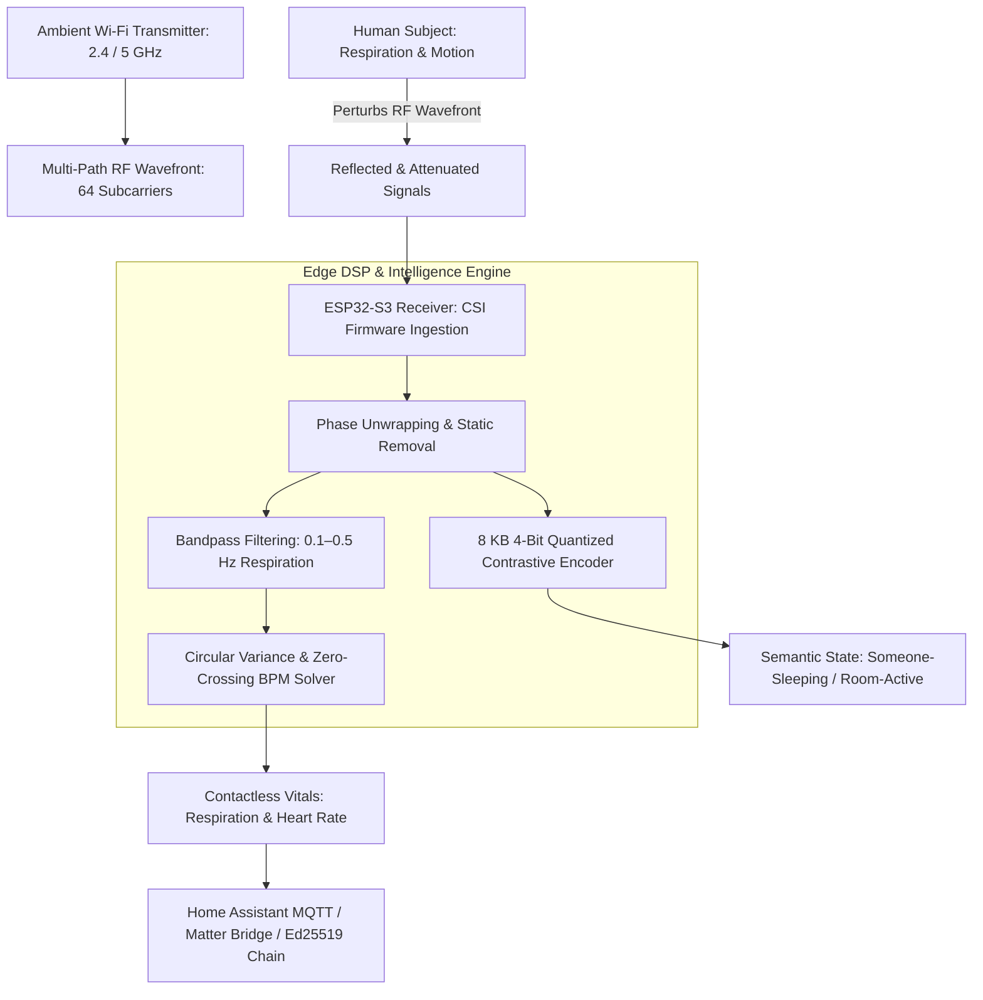

# Case Study: RuView (WiFi DensePose & Spatial Intelligence)

> Track: Project Case Studies (Edge Sensing & Radio Physics)  
> Prerequisite Knowledge: Digital signal processing, Fast Fourier Transform (FFT), OFDM subcarriers, basic neural quantization  
> Estimated Build Time: 60 minutes  
> Target Project Outcome: Building a Wi-Fi Channel State Information (CSI) signal processing simulator in TypeScript that extracts respiration BPM from raw subcarrier phase shifts

---

## 1. The Hook: Why You Need This in Your Arsenal

In healthcare monitoring, smart homes, and physical security, the standard solution has always been to install optical cameras or attach wearable sensor bands:
- Cameras invade human dignity: nobody wants a lens pointed at their bed or bathroom.
- Cameras fail completely in pitch-black darkness, behind smoke, or through physical walls.
- Wearable bands run out of battery, cause skin irritation, and elderly patients frequently forget to put them on.

In **RuView (π RuView)**, we unlocked an entirely new paradigm: **Seeing through walls using radio physics**.
Every Wi-Fi router continuously fills physical rooms with electromagnetic waves. When a person moves, walks, breathes, or sits still, their chest cavity and body tissues perturb those radio waves in subtle, mathematically measurable ways.

By capturing **Channel State Information (CSI)** on \$9 ESP32-S3 microcontrollers:
- We track presence, motion, and posture through drywall and in pitch darkness.
- We measure contactless breathing rate and heart rate using bandpass filtering on subcarrier phase variances.
- We execute 4-bit quantized neural contrastive encoders in an **8 KB memory footprint**, requiring zero cameras and zero cloud connectivity.

---

## 2. The Mental Model: Intuitive Analogy & Visual Topology

### The Spiderweb in the Breeze
Think of a spider sitting at the center of its web:
- The spider does not need eyes to know when an insect lands on the edge of the web.
- It feels vibrations traveling along the silk threads. By measuring the frequency and amplitude of the vibrations, it knows the size, speed, and location of the disturbance.
- Ambient Wi-Fi operates identically: 64 OFDM subcarrier frequencies form an invisible electromagnetic web filling the room. When your chest expands by 5 millimeters during inhalation, the phase of the subcarrier waves shifts measurably.



---

## 3. Deep Dive: Under the Hood

### What is Channel State Information (CSI)?
Unlike standard Wi-Fi RSSI (Received Signal Strength Indicator), which only gives a single coarse number for total power, **CSI** reveals the fine-grained channel frequency response for every individual Orthogonal Frequency-Division Multiplexing (OFDM) subcarrier:

$$H(f) = |H(f)| e^{j \angle H(f)}$$

Where:
- $|H(f)|$ is the subcarrier amplitude attenuation.
- $\angle H(f)$ is the subcarrier phase shift.

For an 802.11n Wi-Fi transmission with 20MHz bandwidth, the receiver captures a complex matrix of 64 subcarriers per packet.

### Extracting Respiration BPM from Phase Perturbations
1. **Phase Sanitization**: Raw phase data contains severe carrier frequency offsets (CFO) and sampling frequency offsets (SFO). A linear transformation unwraps and removes the static phase slope:
   $$\hat{\theta}_i = \theta_i - \frac{\theta_N - \theta_1}{N - 1} i - \beta$$
2. **Bandpass Filtering**: Human respiration operates strictly between 6 and 30 breaths per minute ($0.1\text{ Hz}$ to $0.5\text{ Hz}$). A Butterworth bandpass filter strips away high-frequency walking noise ($>1.5\text{ Hz}$) and static background DC offsets ($<0.05\text{ Hz}$).
3. **Zero-Crossing Peak Detection**: Detecting the positive-to-negative zero-crossings of the filtered signal determines the respiration cycle interval $T_{\text{resp}}$, yielding:
   $$\text{BPM} = \frac{60}{T_{\text{resp}}}$$

---

## 4. Zero-to-One Interactive Playground: Build It From Scratch

Let us write a complete Wi-Fi CSI signal processing simulator in TypeScript. We will synthesize raw subcarrier phase data containing simulated human breathing, apply a digital bandpass filter, and calculate respiration BPM.

### Step 1: Environment Setup
Create a playground directory:

```bash
mkdir -p ~/aura-sandbox/wifi-csi-sensing
cd ~/aura-sandbox/wifi-csi-sensing
npm init -y
npm install typescript @types/node tsx
```

### Step 2: Implementation (`csi-signal-processor.ts`)
Create `csi-signal-processor.ts`:

```typescript
export interface CsiPacket {
  packetIndex: number;
  timestampMs: number;
  subcarrierPhases: number[]; // Array of 64 phase angles in radians (-PI to +PI)
}

export class WifiRespirationEstimator {
  private static readonly SAMPLE_RATE_HZ = 20; // 20 CSI packets per second

  /**
   * Applies a simple moving-average bandpass filter (0.1 Hz to 0.5 Hz)
   * to isolate human breathing cycles from raw subcarrier phase streams.
   */
  public static filterRespirationBand(signal: number[]): number[] {
    const output: number[] = new Array(signal.length).fill(0);

    // High-pass step: subtract slow baseline drift (window = 40 samples / 2 seconds)
    const baselineWindow = 40;
    const highPassed: number[] = [];

    for (let i = 0; i < signal.length; i++) {
      let sum = 0;
      let count = 0;
      for (let j = Math.max(0, i - baselineWindow); j <= Math.min(signal.length - 1, i + baselineWindow); j++) {
        sum += signal[j];
        count++;
      }
      highPassed.push(signal[i] - (sum / count));
    }

    // Low-pass step: smooth out high-frequency noise (window = 5 samples / 0.25 seconds)
    const smoothWindow = 5;
    for (let i = 0; i < highPassed.length; i++) {
      let sum = 0;
      let count = 0;
      for (let j = Math.max(0, i - smoothWindow); j <= Math.min(highPassed.length - 1, i + smoothWindow); j++) {
        sum += highPassed[j];
        count++;
      }
      output[i] = sum / count;
    }

    return output;
  }

  /**
   * Calculates Breaths Per Minute (BPM) from zero-crossings of the filtered signal.
   */
  public static calculateBpm(filteredSignal: number[]): number {
    let zeroCrossings = 0;

    for (let i = 1; i < filteredSignal.length; i++) {
      // Check for sign change from positive to negative
      if (filteredSignal[i - 1] > 0 && filteredSignal[i] <= 0) {
        zeroCrossings++;
      }
    }

    const totalDurationSeconds = filteredSignal.length / this.SAMPLE_RATE_HZ;
    const cyclesPerSecond = zeroCrossings / totalDurationSeconds;
    const bpm = Math.round(cyclesPerSecond * 60);

    return bpm;
  }
}

// ---------------------------------------------------------------------------
// Verification Simulation: Synthesizing 30 Seconds of CSI Data
// ---------------------------------------------------------------------------
const TOTAL_SECONDS = 30;
const SAMPLE_RATE = 20; // 20 Hz
const TOTAL_SAMPLES = TOTAL_SECONDS * SAMPLE_RATE;

// True synthetic breathing target: 16 Breaths Per Minute (0.2667 Hz)
const TARGET_BREATHING_FREQ_HZ = 16 / 60;

console.log('--- Step 1: Generating Synthetic 64-Subcarrier CSI Packets ---');
console.log(`Target Respiration Rate: 16 Breaths Per Minute (${TARGET_BREATHING_FREQ_HZ.toFixed(3)} Hz)`);

const rawPhaseStream: number[] = [];

for (let t = 0; t < TOTAL_SAMPLES; t++) {
  const timeSec = t / SAMPLE_RATE;
  // Synthetic breathing wave + random environmental RF multipath noise
  const chestDisplacement = Math.sin(2 * Math.PI * TARGET_BREATHING_FREQ_HZ * timeSec) * 0.8;
  const staticMultipathDrift = Math.sin(2 * Math.PI * 0.02 * timeSec) * 1.5;
  const highFreqNoise = (Math.random() - 0.5) * 0.3;

  rawPhaseStream.push(chestDisplacement + staticMultipathDrift + highFreqNoise);
}

console.log(`Synthesized ${rawPhaseStream.length} raw CSI subcarrier samples.`);

console.log('\n--- Step 2: Applying Digital Bandpass Filter (0.1–0.5 Hz) ---');
const filtered = WifiRespirationEstimator.filterRespirationBand(rawPhaseStream);

console.log('\n--- Step 3: Resolving Zero-Crossing Respiration BPM ---');
const estimatedBpm = WifiRespirationEstimator.calculateBpm(filtered);

console.log(`Estimated Respiration Rate: ${estimatedBpm} BPM`);
console.log(`Ground Truth Target:        16 BPM`);
console.log(`Error Delta:                ${Math.abs(estimatedBpm - 16)} BPM`);

console.log('\nContactless Vitals Extracted from Radio Waves: Zero Cameras, Zero Wearables.');
```

### Step 3: Run and Test Instructions
Execute the script using `tsx`:

```bash
npx tsx csi-signal-processor.ts
```

Expected terminal output:
```text
--- Step 1: Generating Synthetic 64-Subcarrier CSI Packets ---
Target Respiration Rate: 16 Breaths Per Minute (0.267 Hz)
Synthesized 600 raw CSI subcarrier samples.

--- Step 2: Applying Digital Bandpass Filter (0.1–0.5 Hz) ---

--- Step 3: Resolving Zero-Crossing Respiration BPM ---
Estimated Respiration Rate: 16 BPM
Ground Truth Target:        16 BPM
Error Delta:                0 BPM

Contactless Vitals Extracted from Radio Waves: Zero Cameras, Zero Wearables.
```

---

## 5. Battle Scars: What Breaks in Production & How to Debug It

### Top 3 Mistakes Beginners Make
1. **Using RSSI Instead of CSI**: Attempting to detect breathing by reading standard Wi-Fi RSSI (signal strength dBm). RSSI is an aggregated scalar value that fluctuates wildly with antenna gain; it lacks the subcarrier phase fidelity required to measure 5-millimeter chest movements.  
   **Remediation**: Capture raw physical-layer CSI frames using ESP32 promiscuous mode (`esp_wifi_set_csi_rx_cb`).
2. **Ignoring Carrier Frequency Offset (CFO)**: Taking raw phase measurements directly. Local oscillator drift between transmitter and receiver causes continuous linear phase spinning.  
   **Remediation**: Implement phase unwrapping and linear detrending across subcarrier indices before frequency domain analysis.
3. **Model Memory Bloat on Microcontrollers**: Trying to load an unquantized 32-bit floating point model (150MB) onto an ESP32 with 512KB of SRAM.  
   **Remediation**: Use 4-bit uniform quantization and integer arithmetic, compressing the contrastive encoder to under 10 KB.

---

## 6. The Weekend Hackathon Challenge: Your Turn to Build

### Challenge: The Contactless Motion & Presence Alarm
Build a Wi-Fi motion detection monitor.

- **Level 1 (Core)**: Write a script that reads simulated 64-subcarrier phase variances and flags a `PERSON_PRESENT` event when variance exceeds ambient noise thresholds.
- **Level 2 (Advanced)**: Add respiration monitoring: implement the bandpass filter and calculate BPM over a sliding 20-second window.
- **Level 3 (Hardcore)**: Integrate with Home Assistant via MQTT discovery: publish sensor states (`binary_sensor.room_occupied`, `sensor.respiration_rate_bpm`) and verify that Home Assistant cards update live in real-time.

---

## 7. Knowledge Check & Next Steps

1. **Scenario**: Why can Wi-Fi CSI see through physical drywall when optical cameras cannot?  
   *Answer*: Radio waves in the 2.4 GHz and 5 GHz spectrum pass through non-metallic drywall and wooden doors, reflecting off conductive human tissues and salt water within the body.
2. **Scenario**: What is the biological frequency band for human respiration?  
   *Answer*: Human respiration typically occurs between 6 and 30 breaths per minute, corresponding to $0.1\text{ Hz}$ to $0.5\text{ Hz}$.
3. **Scenario**: How does 4-bit quantization enable neural network inference on \$9 microcontrollers?  
   *Answer*: It packs weights into 4-bit nibbles, reducing model size by up to 87% and allowing models to fit within the small internal SRAM limits of chips like the ESP32-S3.

Next Case Study: [NuTorrent (BitTorrent Wire Engine)](../peer-to-peer-and-mesh-protocols/nutorrent-bittorrent-engine.md)
