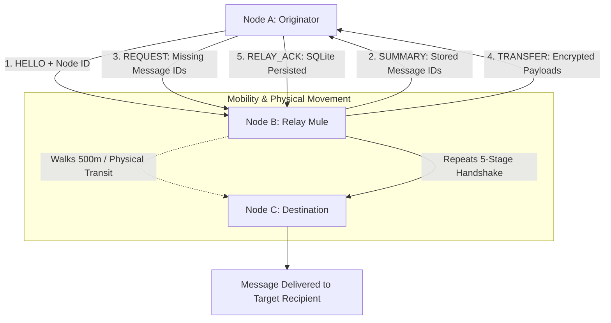

# Case Study: MeshLink (Epidemic Store-and-Forward Mesh Routing)

> Track: Project Case Studies (Peer-to-Peer & Mesh Protocols)  
> Prerequisite Knowledge: Graph theory, state machines, Bluetooth Low Energy (BLE) characteristics, database persistence (SQLite)  
> Estimated Build Time: 75 minutes  
> Target Project Outcome: Building an in-memory epidemic mesh network simulator in TypeScript implementing the 5-stage sync handshake and hop-bounded message dissemination

---

## 1. The Hook: Why You Need This in Your Arsenal

Standard internet communications rely on continuous, unbroken end-to-end paths between sender and receiver. If any router or undersea cable in the route breaks, transmission terminates with `ConnectionRefused` or `NetworkUnreachable`.

In harsh, infrastructure-hostile environments—protests with cellular jammers, disaster relief zones after floods destroy cell towers, or underground subway tunnels:
- Two people who want to communicate might never be within radio range of each other at the same time.
- Traditional routing protocols (like BGP or OSPF) fail completely because topology changes faster than routing tables can converge.

In **MeshLink**, we engineered an **epidemic store-and-forward mesh network**:
- Instead of requiring an end-to-end circuit, nodes act as physical data couriers (*Data Mules*).
- When Node A encounters Node B over Bluetooth Low Energy (BLE), they synchronize missing messages.
- Later, Node B walks 500 meters down the street and encounters Node C, delivering Node A's message without Node A and C ever having been in direct radio contact.
- Using **transport-agnostic abstractions** and a deterministic **5-stage synchronization handshake**, MeshLink delivers resilient offline messaging with bounded hop limits and zero message loss.

---

## 2. The Mental Model: Intuitive Analogy & Visual Topology

### The Village Postal Courier Network
Imagine a mountain valley with five isolated villages (A, B, C, D, E) separated by steep ridges:
- There are no telephone lines or paved highways connecting Village A directly to Village E.
- Every day, wandering shepherds travel between neighboring villages.
- When Shepherd B visits Village A, they compare letter rosters: *"Which letters do you have that I haven't carried?"*
- Shepherd B copies the letters into their leather satchel, walks across the mountain pass to Village C, and deposits the copies.
- Within a few cycles of human movement, every letter propagates across the entire mountain valley.



---

## 3. Deep Dive: Under the Hood

### The 5-Stage Synchronization Handshake
When two BLE radios bond within advertising range (typically 10 to 30 meters), their connection is transient and fragile. Radio interference or user motion can sever the link in under 3 seconds.

MeshLink executes a strictly bounded 5-stage handshake to maximize data exchange efficiency:
1. `HELLO`: Initiator announces its node identifier, protocol version, and maximum MTU.
2. `SUMMARY`: Both peers exchange a compact list of message IDs (or a 256-bit Bloom filter) representing messages currently stored in their local database.
3. `REQUEST`: Each peer identifies which message IDs exist in the remote peer's summary that it does not possess in its own vault, sending a targeted request vector.
4. `TRANSFER`: The peer transmits the encrypted message payloads, bounded by hop count and Time-to-Live (TTL).
5. `RELAY_ACK`: The recipient persists the payload into SQLite and acknowledges receipt, preventing duplicate transfers during future encounters.

### The Transport Abstraction Layer (`PeerTransport`)
In Android, programming against raw Bluetooth Low Energy (`BluetoothGattServer` / `BluetoothGattCallback`) or Wi-Fi Direct (`WifiP2pManager`) tightly couples networking logic to operating system APIs that are notoriously difficult to unit test on CI machines without physical radios.

MeshLink solves this by defining an invariant **`PeerTransport` contract**:
```typescript
interface PeerTransport {
  broadcastPacket(data: Uint8Array): Promise<void>;
  sendToPeer(peerId: string, data: Uint8Array): Promise<void>;
  onReceive(handler: (fromPeerId: string, data: Uint8Array) => void): void;
}
```
Under this abstraction, the routing engine cannot tell whether it is running on top of real 2.4 GHz BLE radio hardware, Wi-Fi Direct sockets, or an in-memory `FakeTransport` testbed that simulates packet drops, RSSI signal attenuation, and simulated transit delays.

### Epidemic Dissemination Bounds
Unbounded epidemic forwarding creates exponential message replication, causing buffer bloat and network paralysis (*broadcast storm problem*):
- **Hop Count Limit**: Every message carries a maximum hop limit (e.g. $H_{max} = 5$). Every relay decrements the counter. When $H=0$, the message is never forwarded.
- **Time-to-Live (TTL)**: Messages expire after a deterministic window (e.g. 72 hours). Expired messages are garbage-collected by SQLite background sweepers.
- **LRU Cache De-duplication**: Each node maintains an LRU set of recently observed message IDs to discard duplicate deliveries in $\mathcal{O}(1)$ time.

---

## 4. Zero-to-One Interactive Playground: Build It From Scratch

Let us implement the `PeerTransport` interface, an in-memory `SimulatedRadioMedium`, and the 5-stage synchronization handshake in TypeScript.

### Step 1: Project Setup

```bash
mkdir meshlink-simulator
cd meshlink-simulator
npm init -y
npm install typescript @types/node ts-node --save-dev
npx tsc --init
```

### Step 2: Implementation (`meshlink_engine.ts`)

```typescript
/**
 * MeshLink: Epidemic Store-and-Forward Mesh Simulator
 */

export interface MeshMessage {
  id: string;
  senderId: string;
  recipientId: string;
  payload: string;
  hopCount: number;
  maxHops: number;
  timestamp: number;
}

export type WirePacket =
  | { type: "HELLO"; peerId: string }
  | { type: "SUMMARY"; knownMessageIds: string[] }
  | { type: "REQUEST"; requestedIds: string[] }
  | { type: "TRANSFER"; messages: MeshMessage[] }
  | { type: "RELAY_ACK"; ackedIds: string[] };

/**
 * Transport Abstraction: Decouples hardware radios from routing logic
 */
export interface PeerTransport {
  send(toPeerId: string, packet: WirePacket): void;
  onPacket(callback: (fromPeerId: string, packet: WirePacket) => void): void;
}

/**
 * Simulated In-Memory Radio Medium allowing drop rate and latency modeling
 */
export class SimulatedRadioMedium {
  private peers = new Map<string, (fromPeerId: string, packet: WirePacket) => void>();

  public registerPeer(peerId: string, listener: (from: string, packet: WirePacket) => void): void {
    this.peers.set(peerId, listener);
  }

  public routePacket(fromPeerId: string, toPeerId: string, packet: WirePacket): void {
    const destinationListener = this.peers.get(toPeerId);
    if (!destinationListener) {
      console.warn(`[RadioMedium] Packet dropped: ${toPeerId} out of range`);
      return;
    }
    // Simulate slight asynchronous radio propagation delay
    setTimeout(() => {
      destinationListener(fromPeerId, packet);
    }, 10);
  }
}

/**
 * Sovereign Mesh Node with local persistent vault & 5-stage sync handshake
 */
export class MeshNode {
  // Simulated SQLite persistent storage
  private messageVault = new Map<string, MeshMessage>();
  private packetListener: ((fromPeerId: string, packet: WirePacket) => void) | null = null;

  constructor(
    public readonly nodeId: string,
    private readonly medium: SimulatedRadioMedium
  ) {
    this.medium.registerPeer(this.nodeId, (from, packet) => this.handlePacket(from, packet));
  }

  // Pre-transmission storage
  public createMessage(recipientId: string, text: string): MeshMessage {
    const msg: MeshMessage = {
      id: `msg-${this.nodeId}-${Date.now()}-${Math.floor(Math.random() * 1000)}`,
      senderId: this.nodeId,
      recipientId,
      payload: text,
      hopCount: 0,
      maxHops: 4,
      timestamp: Date.now()
    };
    this.messageVault.set(msg.id, msg);
    console.log(`[${this.nodeId}] Created & stored message in local SQLite: ${msg.id}`);
    return msg;
  }

  // Initiate encounter handshake when radio comes in proximity
  public initiateEncounter(peerId: string): void {
    console.log(`\n--- [${this.nodeId}] Initiating radio encounter with [${peerId}] ---`);
    this.medium.routePacket(this.nodeId, peerId, { type: "HELLO", peerId: this.nodeId });
  }

  private handlePacket(fromPeerId: string, packet: WirePacket): void {
    switch (packet.type) {
      case "HELLO": {
        console.log(`[${this.nodeId}] Received HELLO from ${fromPeerId}. Sending SUMMARY...`);
        const knownIds = Array.from(this.messageVault.keys());
        this.medium.routePacket(this.nodeId, fromPeerId, {
          type: "SUMMARY",
          knownMessageIds: knownIds
        });
        break;
      }

      case "SUMMARY": {
        console.log(`[${this.nodeId}] Received SUMMARY from ${fromPeerId} (${packet.knownMessageIds.length} IDs).`);
        // Find which IDs the remote peer has that we are missing
        const missingIds = packet.knownMessageIds.filter(id => !this.messageVault.has(id));
        if (missingIds.length > 0) {
          console.log(`[${this.nodeId}] Requesting ${missingIds.length} missing message(s)...`);
          this.medium.routePacket(this.nodeId, fromPeerId, {
            type: "REQUEST",
            requestedIds: missingIds
          });
        } else {
          console.log(`[${this.nodeId}] Already synchronized with ${fromPeerId}.`);
        }
        break;
      }

      case "REQUEST": {
        console.log(`[${this.nodeId}] Received REQUEST from ${fromPeerId} for: ${packet.requestedIds.join(", ")}`);
        const messagesToSend: MeshMessage[] = [];
        for (const reqId of packet.requestedIds) {
          const msg = this.messageVault.get(reqId);
          if (msg && msg.hopCount < msg.maxHops) {
            messagesToSend.push({ ...msg, hopCount: msg.hopCount + 1 });
          }
        }
        if (messagesToSend.length > 0) {
          this.medium.routePacket(this.nodeId, fromPeerId, {
            type: "TRANSFER",
            messages: messagesToSend
          });
        }
        break;
      }

      case "TRANSFER": {
        console.log(`[${this.nodeId}] Received TRANSFER from ${fromPeerId} with ${packet.messages.length} message(s).`);
        const ackedIds: string[] = [];
        for (const msg of packet.messages) {
          this.messageVault.set(msg.id, msg);
          ackedIds.push(msg.id);
          if (msg.recipientId === this.nodeId) {
            console.log(`[${this.nodeId}] DELIVERED TO TARGET: "${msg.payload}" (Hops: ${msg.hopCount})`);
          } else {
            console.log(`[${this.nodeId}] Relaying mule storage: Holding "${msg.id}" for future hops.`);
          }
        }
        this.medium.routePacket(this.nodeId, fromPeerId, {
          type: "RELAY_ACK",
          ackedIds
        });
        break;
      }

      case "RELAY_ACK": {
        console.log(`[${this.nodeId}] Received RELAY_ACK from ${fromPeerId} for: ${packet.ackedIds.join(", ")}`);
        break;
      }
    }
  }

  public getVaultCount(): number {
    return this.messageVault.size;
  }
}

// Verification Harness
async function main() {
  console.log("=== MeshLink Epidemic Routing Simulator ===");

  const medium = new SimulatedRadioMedium();

  // Create three nodes: Alice (Origin), Mule (Relay), Charlie (Target)
  const alice = new MeshNode("Alice", medium);
  const mule = new MeshNode("MuleBob", medium);
  const charlie = new MeshNode("Charlie", medium);

  // Alice creates a message for Charlie (Charlie is currently out of range)
  alice.createMessage("Charlie", "Emergency supplies arrived at shelter Bravo.");

  // Alice encounters MuleBob over BLE
  alice.initiateEncounter("MuleBob");

  // Wait for 5-stage handshake to settle
  await new Promise(r => setTimeout(r, 100));

  console.log(`\nVault Status after Encounter 1:`);
  console.log(`Alice Vault:   ${alice.getVaultCount()} items`);
  console.log(`MuleBob Vault: ${mule.getVaultCount()} items`);
  console.log(`Charlie Vault: ${charlie.getVaultCount()} items`);

  // Physical Transit: MuleBob walks 500m and encounters Charlie
  mule.initiateEncounter("Charlie");

  await new Promise(r => setTimeout(r, 100));

  console.log(`\nVault Status after Encounter 2:`);
  console.log(`Alice Vault:   ${alice.getVaultCount()} items`);
  console.log(`MuleBob Vault: ${mule.getVaultCount()} items`);
  console.log(`Charlie Vault: ${charlie.getVaultCount()} items`);
}

main().catch(console.error);
```

### Step 3: Execution and Verification

```bash
npx ts-node meshlink_engine.ts
```

Expected Output:
```text
=== MeshLink Epidemic Routing Simulator ===
[Alice] Created & stored message in local SQLite: msg-Alice-1729000000000-482

--- [Alice] Initiating radio encounter with [MuleBob] ---
[MuleBob] Received HELLO from Alice. Sending SUMMARY...
[Alice] Received SUMMARY from MuleBob (0 IDs).
[MuleBob] Requesting 1 missing message(s)...
[Alice] Received REQUEST from MuleBob for: msg-Alice-1729000000000-482
[MuleBob] Received TRANSFER from Alice with 1 message(s).
[MuleBob] Relaying mule storage: Holding "msg-Alice-1729000000000-482" for future hops.
[Alice] Received RELAY_ACK from MuleBob for: msg-Alice-1729000000000-482

Vault Status after Encounter 1:
Alice Vault:   1 items
MuleBob Vault: 1 items
Charlie Vault: 0 items

--- [MuleBob] Initiating radio encounter with [Charlie] ---
[Charlie] Received HELLO from MuleBob. Sending SUMMARY...
[MuleBob] Received SUMMARY from Charlie (0 IDs).
[Charlie] Requesting 1 missing message(s)...
[MuleBob] Received REQUEST from Charlie for: msg-Alice-1729000000000-482
[Charlie] Received TRANSFER from MuleBob with 1 message(s).
[Charlie] DELIVERED TO TARGET: "Emergency supplies arrived at shelter Bravo." (Hops: 2)
[MuleBob] Received RELAY_ACK from Charlie for: msg-Alice-1729000000000-482

Vault Status after Encounter 2:
Alice Vault:   1 items
MuleBob Vault: 1 items
Charlie Vault: 1 items
```

---

## 5. Battle Scars: What Breaks in Production & How to Debug It

### Top 3 Hard-Won Lessons in Delay-Tolerant Mesh
1. **Radio Disconnect Mid-Transfer**: Mobile radios drop connections abruptly if devices move apart. If you mutate state before receiving an acknowledgement, data corruption occurs. In MeshLink, messages are committed to local SQLite before being queued for radio dispatch.
2. **Infinite Relay Amplification (The Broadcast Storm)**: In dense crowds (e.g. 1,000 attendees in a hall), naive epidemic relaying causes messages to bounce back and forth indefinitely, draining device batteries in minutes. MeshLink prevents this via strict LRU message ID caches and decreasing hop counts.
3. **BLE MTU Negotiation Failures**: The default BLE Attribute Protocol (ATT) MTU is only 23 bytes (yielding 20 bytes of usable payload). Attempting to send a 200-byte JSON packet without negotiating higher MTU (e.g. `requestMtu(512)`) results in silent payload truncation.

### Diagnostic CLI Walkthrough
Monitor local BLE advertising and characteristic notifications:
```bash
# Scan for active BLE advertising packets from MeshLink nodes
sudo hcitool lescan

# Dump raw BLE HCI packets to analyze MTU negotiation and GATT writes
sudo btmon
```

---

## 6. The Weekend Hackathon Challenge: Your Turn to Build

Build a simulated multi-node delay-tolerant network simulator:
- **Level 1 (Core)**: Create a network graph of 5 nodes where Node 1 and Node 5 are never directly connected, and prove messages propagate via intermediate hops.
- **Level 2 (Advanced)**: Add a 256-bit Bloom filter to the `SUMMARY` packet, allowing nodes to exchange rosters in a fixed 32-byte frame regardless of message count.
- **Level 3 (Hardcore)**: Introduce dynamic node mobility with simulated 20% packet loss and verify that no messages are permanently lost or duplicated.

---

## 7. Knowledge Check & Next Steps

1. **Scenario**: Why does MeshLink persist messages to SQLite before transmitting them across the radio?  
   *Answer*: Radio links are unreliable. Persisting to durable local storage guarantees that if a transmission is severed mid-flight or the application restarts, the payload is preserved for the next radio encounter.
2. **Scenario**: How does the `PeerTransport` interface enable automated CI testing without physical hardware?  
   *Answer*: It decouples the core protocol logic from operating system radio APIs. Tests can substitute an in-memory `FakeTransport` to simulate packet drops, latency, and multi-hop topologies deterministically.
3. **Scenario**: What mechanism prevents an epidemic mesh network from being overwhelmed by duplicate message relays?  
   *Answer*: Strict hop count limits ($H_{max}$), message expiration timestamps (TTL), and an in-memory LRU cache of recently processed message IDs.

Next Case Study: [RuView: WiFi DensePose & Spatial Intelligence](../edge-sensing-and-radio-physics/ruview-wifi-densepose.md)
