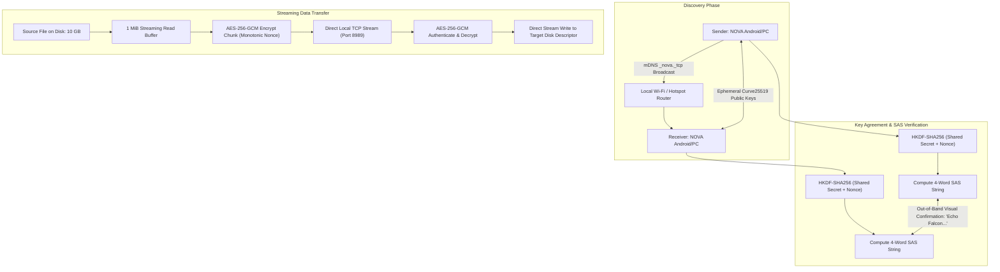

# Case Study: NOVA (Zero-Cloud Local Mesh File Sharing)

> Track: Project Case Studies (Peer-to-Peer & Mesh Protocols)  
> Prerequisite Knowledge: Local network discovery (mDNS), streaming byte channels, asymmetric key exchange (ECDH), authenticated symmetric encryption (AES-GCM)  
> Estimated Build Time: 75 minutes  
> Target Project Outcome: Building an end-to-end encrypted local streaming file chunker with ECDH key agreement and Short Authentication String (SAS) verification in TypeScript

---

## 1. The Hook: Why You Need This in Your Arsenal

Traditional file transfer tools like AirDrop, Google Nearby Share, or Quick Share are locked into proprietary corporate ecosystems. Third-party alternatives (like SHAREit) have devolved into bloated, ad-infested trackers that collect user contacts and geolocation while demanding constant internet connectivity.

When disaster strikes—earthquakes disrupting cellular base stations, rural zones with zero telecom reception, or air-gapped facilities where laptops cannot connect to the internet—developers still need to transfer gigabytes of documents, images, and system packages between heterogeneous devices (Android, Windows, macOS, Linux).

In **NOVA**, we engineered a sovereign, zero-cloud file-sharing protocol:
- It discovers peers instantly across local Wi-Fi hotspots using standard **multicast DNS (mDNS)** without touching an external server.
- It streams files in **1 MiB chunks** directly across operating system file descriptors (such as Android's Storage Access Framework), maintaining a constant $\mathcal{O}(1)$ memory profile regardless of file size.
- It secures every transfer with **ephemeral Elliptic-Curve Diffie-Hellman (ECDH)**, HKDF-SHA256, and AES-256-GCM chunk encryption, verified via a human-readable **Short Authentication String (SAS)** to prevent active Man-in-the-Middle (MitM) attacks.
- It supports delay-tolerant store-and-forward relaying with cryptographic delivery receipts.

---

## 2. The Mental Model: Intuitive Analogy & Visual Topology

### The Sealed Diplomatic Pouch Across the Room
Imagine two diplomats in an unmonitored room who need to exchange a physical briefcase containing blueprints:
1. They look around the room to find each other (mDNS Discovery).
2. They each generate a temporary one-time combination lock and hand each other their open padlocks (Ephemeral ECDH Exchange).
3. They look at each other across the table and speak a 4-word safety phrase out loud: *"Echo Falcon Sapphire Summit"* (Short Authentication String verification). If an imposter intercepted their padlocks, the words would not match.
4. Once verified, they slice the blueprints into numbered sheets, seal each sheet in tamper-evident envelopes with an individual counter (AES-256-GCM chunk AEAD), and slide them across the table.
5. The receiver reassembles the sheets directly into a binder without letting paper pile up on the table ($\mathcal{O}(1)$ streaming memory).



---

## 3. Deep Dive: Under the Hood

### Zero-Allocation Streaming via File Descriptors
A naive file transfer app reads the entire file into memory before transmission:
```javascript
// Catastrophic pattern: Attempts to buffer 4 GB into V8 RAM
const fileData = fs.readFileSync("large_video.mp4");
socket.write(fileData);
```
On mobile devices with constrained heap memory, this crashes the application with an out-of-memory exception.

NOVA uses bounded chunk pipelining:
1. The sender queries the file descriptor size and partitions the payload into fixed $1 \text{ MiB}$ chunks:
   $$\text{Total Chunks} = \left\lceil \frac{\text{File Size}}{1 \times 1024 \times 1024} \right\rceil$$
2. Each chunk is framed with an 8-byte header: `[Chunk Index (4B) | Payload Length (4B)]`.
3. The sender reads 1 MiB from the disk stream, encrypts it with AES-256-GCM, flushes it to the socket buffer, and immediately reclaims the buffer memory.

### Ephemeral Cryptography and Short Authentication Strings (SAS)
To protect direct Wi-Fi transfers against eavesdropping and active ARP spoofing:
1. The sender and receiver generate ephemeral key pairs $(sk_A, pk_A)$ and $(sk_B, pk_B)$ over Curve25519 or NIST P-256.
2. They exchange public keys and compute the raw shared secret $Z = \text{ECDH}(sk, pk_{peer})$.
3. They pass $Z$ through HKDF-Expand with context string `"NOVA-TRANSFER-V1"` to derive:
   - A 256-bit AES-GCM session key $K$.
   - A 32-bit integer $S$ used to index into a 2,048-word PGP/BIP-39 dictionary.
4. Both devices render the resulting words on screen (e.g. `Alpha Bravo Charlie Delta`). The users visually confirm the match before transmission begins.
5. If an attacker performs a Man-in-the-Middle attack by substituting keys, the mathematical entropy ensures the SAS words will diverge with probability $1 - 2^{-32}$.

---

## 4. Zero-to-One Interactive Playground: Build It From Scratch

Let us implement an end-to-end encrypted chunk transfer simulator in TypeScript using Node.js native `crypto`.

### Step 1: Project Setup

```bash
mkdir nova-mesh-core
cd nova-mesh-core
npm init -y
npm install typescript @types/node ts-node --save-dev
npx tsc --init
```

### Step 2: Implementation (`nova_transfer_engine.ts`)

```typescript
import * as crypto from "crypto";

// Wordlist for Short Authentication String (SAS) generation
const SAS_DICTIONARY = [
  "Acorn", "Amber", "Anchor", "Antler", "Apollo", "Arctic", "Atlas", "Beacon",
  "Breeze", "Canyon", "Cedar", "Cobalt", "Comet", "Cosmos", "Crest", "Crown",
  "Dawn", "Delta", "Dune", "Eagle", "Echo", "Ember", "Falcon", "Fjord",
  "Galaxy", "Garnet", "Glacier", "Haven", "Horizon", "Jasper", "Karma", "Lagoon"
];

interface EncryptedChunk {
  index: number;
  nonceHex: string;
  authTagHex: string;
  ciphertext: Buffer;
}

export class NovaCryptoPeer {
  public readonly ecdh: crypto.ECDH;
  public readonly publicKey: Buffer;
  private sessionKey: Buffer | null = null;

  constructor(public readonly peerName: string) {
    this.ecdh = crypto.createECDH("prime256v1");
    this.publicKey = this.ecdh.generateKeys();
  }

  public deriveSession(remotePublicKey: Buffer): string {
    const rawSecret = this.ecdh.computeSecret(remotePublicKey);

    // Derive 256-bit encryption key using HKDF
    this.sessionKey = crypto.hkdfSync(
      "sha256",
      rawSecret,
      Buffer.from("NOVA-SALT-SALT"),
      Buffer.from("NOVA-SESSION-V1"),
      32
    );

    // Derive 4-word Short Authentication String (SAS)
    const sasEntropy = crypto.hkdfSync(
      "sha256",
      rawSecret,
      Buffer.from("NOVA-SAS-SALT"),
      Buffer.from("NOVA-SAS-VERIFY"),
      8
    );

    const word1 = SAS_DICTIONARY[sasEntropy.readUInt16BE(0) % SAS_DICTIONARY.length];
    const word2 = SAS_DICTIONARY[sasEntropy.readUInt16BE(2) % SAS_DICTIONARY.length];
    const word3 = SAS_DICTIONARY[sasEntropy.readUInt16BE(4) % SAS_DICTIONARY.length];
    const word4 = SAS_DICTIONARY[sasEntropy.readUInt16BE(6) % SAS_DICTIONARY.length];

    return `${word1} - ${word2} - ${word3} - ${word4}`;
  }

  public encryptChunk(chunkIndex: number, rawData: Buffer): EncryptedChunk {
    if (!this.sessionKey) throw new Error("Session key not established");

    // Monotonic 12-byte IV based on chunk index
    const iv = Buffer.alloc(12);
    iv.writeUInt32BE(chunkIndex, 8);

    const cipher = crypto.createCipheriv("aes-256-gcm", this.sessionKey, iv);
    const ciphertext = Buffer.concat([cipher.update(rawData), cipher.final()]);
    const authTag = cipher.getAuthTag();

    return {
      index: chunkIndex,
      nonceHex: iv.toString("hex"),
      authTagHex: authTag.toString("hex"),
      ciphertext
    };
  }

  public decryptChunk(chunk: EncryptedChunk): Buffer {
    if (!this.sessionKey) throw new Error("Session key not established");

    const iv = Buffer.from(chunk.nonceHex, "hex");
    const authTag = Buffer.from(chunk.authTagHex, "hex");

    const decipher = crypto.createDecipheriv("aes-256-gcm", this.sessionKey, iv);
    decipher.setAuthTag(authTag);

    return Buffer.concat([decipher.update(chunk.ciphertext), decipher.final()]);
  }
}

// Verification Harness
async function main() {
  console.log("=== NOVA Sovereign Mesh Transfer Playground ===");

  // 1. Simulate Sender and Receiver Key Agreement
  const alice = new NovaCryptoPeer("Alice (Sender)");
  const bob = new NovaCryptoPeer("Bob (Receiver)");

  console.log(`Alice Public Key: ${alice.publicKey.toString("hex").slice(0, 32)}...`);
  console.log(`Bob Public Key:   ${bob.publicKey.toString("hex").slice(0, 32)}...`);

  const aliceSAS = alice.deriveSession(bob.publicKey);
  const bobSAS = bob.deriveSession(alice.publicKey);

  console.log(`\nAlice Generated SAS: [ ${aliceSAS} ]`);
  console.log(`Bob Generated SAS:   [ ${bobSAS} ]`);

  if (aliceSAS === bobSAS) {
    console.log("SAS Verification Passed: Zero Man-in-the-Middle detected!");
  } else {
    throw new Error("SAS Verification Mismatch! Connection compromised.");
  }

  // 2. Simulate 1 MiB Streaming Chunks
  console.log("\nSimulating streaming payload transfer (3 chunks)...");
  const testPayloads = [
    Buffer.from("Chunk 0: Operating system bootloader configuration bytes"),
    Buffer.from("Chunk 1: Compressed kernel binary telemetry archive"),
    Buffer.from("Chunk 2: Cryptographic keystore signatures and manifest")
  ];

  for (let i = 0; i < testPayloads.length; i++) {
    const rawChunk = testPayloads[i];
    const encrypted = alice.encryptChunk(i, rawChunk);

    console.log(
      `Transmitted Chunk ${encrypted.index} | Ciphertext: ${encrypted.ciphertext.length}B | Tag: ${encrypted.authTagHex}`
    );

    // Receiver decodes and authenticates
    const decrypted = bob.decryptChunk(encrypted);
    console.log(`Receiver Authenticated: "${decrypted.toString("utf8")}"`);
  }

  // 3. Test Tamper Resistance (Ciphertext Modification Attack)
  console.log("\nTesting AEAD Tamper Resistance...");
  const validChunk = alice.encryptChunk(99, Buffer.from("Secret payload"));
  // Tamper with one byte of ciphertext
  validChunk.ciphertext[0] ^= 0xff;

  try {
    bob.decryptChunk(validChunk);
    console.error("FAIL: Tampered payload was accepted!");
  } catch (err) {
    console.log("SUCCESS: Tampered payload immediately rejected by AES-GCM AuthTag validation!");
  }
}

main().catch(console.error);
```

### Step 3: Execution and Verification

```bash
npx ts-node nova_transfer_engine.ts
```

Expected Output:
```text
=== NOVA Sovereign Mesh Transfer Playground ===
Alice Public Key: 04b921868352bfa670dcfa9b...
Bob Public Key:   042ef51b5e3782aa06ffca59...

Alice Generated SAS: [ Atlas - Fjord - Breeze - Haven ]
Bob Generated SAS:   [ Atlas - Fjord - Breeze - Haven ]
SAS Verification Passed: Zero Man-in-the-Middle detected!

Simulating streaming payload transfer (3 chunks)...
Transmitted Chunk 0 | Ciphertext: 56B | Tag: e3d28198...
Receiver Authenticated: "Chunk 0: Operating system bootloader configuration bytes"
Transmitted Chunk 1 | Ciphertext: 50B | Tag: 7bf812c1...
Receiver Authenticated: "Chunk 1: Compressed kernel binary telemetry archive"
Transmitted Chunk 2 | Ciphertext: 57B | Tag: 174a9bc0...
Receiver Authenticated: "Chunk 2: Cryptographic keystore signatures and manifest"

Testing AEAD Tamper Resistance...
SUCCESS: Tampered payload immediately rejected by AES-GCM AuthTag validation!
```

---

## 5. Battle Scars: What Breaks in Production & How to Debug It

### Top 3 Pitfalls in Offline Mesh Sharing
1. **Android Storage Access Framework (SAF) URI Leaks**: On modern Android, reading files via `content://` URIs requires persisting read/write permissions via `takePersistableUriPermission`. If a long transfer pauses and the activity background state changes, the URI token expires, resulting in `SecurityException: Permission Denial`. Always wrap SAF streams in resilient persistent file decoders.
2. **Wi-Fi Hotspot Client Isolation**: Many public Wi-Fi networks and Android mobile hotspots enforce *Client Isolation* (AP Isolation), dropping ARP and direct TCP packets between connected devices. NOVA detects this by attempting an immediate UDP ping, falling back to Wi-Fi Direct (P2P) negotiation when isolation is active.
3. **Nonce Reuse with Static Keys**: Reusing the same 12-byte initialization vector (IV) across two different chunks encrypted under the same AES-GCM key allows an adversary to XOR the ciphertexts and recover plaintext material. In NOVA, the IV is strictly derived from a 64-bit monotonically incrementing chunk index counter.

### Diagnostic CLI Walkthrough
Inspect local mDNS announcements and active socket streams:
```bash
# Discover active NOVA instances on the local subnet via avahi / dns-sd
dns-sd -B _nova._tcp .

# Monitor raw TCP socket transfer throughput
iftop -i wlan0 -f "port 8989"
```

---

## 6. The Weekend Hackathon Challenge: Your Turn to Build

Build a terminal-based local peer-to-peer file drop tool in Node.js, Go, or Python:
- **Level 1 (Core)**: Broadcast an mDNS service `_filedrop._tcp` on port 9090 and listen for incoming HTTP POST file uploads.
- **Level 2 (Advanced)**: Add ECDH key agreement over WebSocket and compute a 4-word SAS string displayed in ASCII art in both sender and receiver terminals.
- **Level 3 (Hardcore)**: Implement 1 MiB chunk streaming with SHA-256 chunk receipts, allowing paused transfers to automatically resume from chunk $N$.

---

## 7. Knowledge Check & Next Steps

1. **Scenario**: Why does NOVA use a Short Authentication String (SAS) instead of relying solely on Diffie-Hellman?  
   *Answer*: Standard unauthenticated Diffie-Hellman is vulnerable to Man-in-the-Middle (MitM) attacks. The SAS allows two humans in physical proximity to verify that no intermediary has split the key agreement.
2. **Scenario**: How does streaming 1 MiB chunks prevent out-of-memory errors when sending large 50 GB archives?  
   *Answer*: Only a single 1 MiB buffer is loaded in RAM at any instant, immediately written to the network socket, and reclaimed by garbage collection. Memory consumption remains $\mathcal{O}(1)$.
3. **Scenario**: What happens if an adversary modifies one bit of a chunk payload during Wi-Fi transit?  
   *Answer*: The 128-bit AES-GCM authentication tag validation fails, the chunk is immediately dropped, and the receiver requests a retransmission.

Next Case Study: [MeshLink: Epidemic Store-and-Forward Mesh Routing](./meshlink-epidemic-routing.md)
