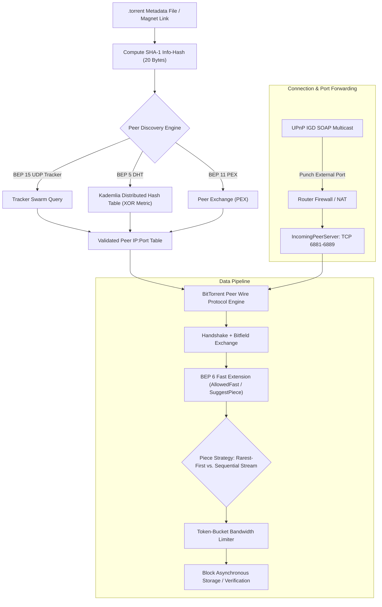

# Case Study: NuTorrent (Cross-Platform BitTorrent Engine)

> Track: Project Case Studies (Peer-to-Peer & Mesh Protocols)  
> Prerequisite Knowledge: TCP/UDP sockets, binary buffer manipulation, asynchronous coroutines / event loops, hash functions (SHA-1)  
> Estimated Build Time: 75 minutes  
> Target Project Outcome: Building a complete BitTorrent Bencode parser and a token-bucket bandwidth throttle in TypeScript from scratch

---

## 1. The Hook: Why You Need This in Your Arsenal

Centralized client-server architectures suffer from a fundamental economic and operational bottleneck: **bandwidth scales linearly with user count**.
- If a studio releases an open-source 4 GB operating system ISO and 100,000 developers download it simultaneously, the origin server must egress 400 Terabytes of data. Server costs explode, bandwidth saturates, and the download speed slows to a crawl for everyone.
- If the central server suffers an outage or faces regional ISP censorship, the entire distribution network vanishes.

The **BitTorrent protocol** (formalized across BEP specifications) solves this inverted scaling problem:
- In a BitTorrent swarm, **every downloader is simultaneously an uploader**. As the number of interested peers increases, the collective bandwidth of the network increases rather than decreases.
- Files are divided into deterministic cryptographic pieces (typically 256 KB to 4 MB) verified by individual SHA-1 hashes declared inside an immutable `info` dictionary.
- In **NuTorrent**, we engineered a cross-platform sovereign BitTorrent client engine in Kotlin Multiplatform (KMP), sharing 85% of core protocol logic across Android and Windows Desktop (Compose Multiplatform).

Mastering decentralized wire protocols elevates an engineer from simply calling HTTP REST APIs to architecting resilient, zero-server distributed distribution systems.

---

## 2. The Mental Model: Intuitive Analogy & Visual Topology

### The Swarm Potluck Dinner
Imagine a potluck dinner where 50 guests arrive to assemble a complex 1,000-page recipe book:
- Instead of one chef photocopying 1,000 pages for 50 people (which would exhaust the chef), each guest brings 20 unique pages.
- Guests circulate around the room, asking each other: *"Which pages do you have that I am missing?"*
- Guest A hands pages 10–19 to Guest B, while Guest B simultaneously hands pages 40–49 to Guest A.
- Within minutes, all 50 guests possess the entire 1,000-page book, and the original chef only had to upload each page once.



---

## 3. Deep Dive: Under the Hood

### The Bencode Binary Wire Format
BitTorrent metadata files (`.torrent`), tracker responses, and DHT RPC messages are serialized using **Bencode**. Bencode is a compact, human-readable binary format supporting exactly four primitives:

1. **Integers**: Delimited by `i` and `e`. Example: `i42e` represents the integer `42`. Negative integers: `i-15e`.
2. **Byte Strings**: Formatted as `<length>:<data>`. Example: `4:spam` represents the string `"spam"`.
3. **Lists**: Delimited by `l` and `e`, containing contiguous Bencode elements. Example: `l4:spami42ee` represents `["spam", 42]`.
4. **Dictionaries**: Delimited by `d` and `e`, containing alternating string keys and arbitrary values. Keys must be byte strings sorted lexicographically. Example: `d3:bar4:spam3:fooi42ee` represents `{"bar": "spam", "foo": 42}`.

Because dictionaries require strict lexicographical ordering of keys, the SHA-1 digest of the serialized `info` dictionary produces a globally unique, deterministic 20-byte identifier known as the **Info-Hash**.

### Kademlia Distributed Hash Table (BEP 5)
When centralized trackers go offline, trackerless swarms discover peers via a distributed hash table (DHT) based on Kademlia:
- Nodes and torrent info-hashes occupy the same 160-bit address space.
- The distance metric between two identifiers $x$ and $y$ is computed as the bitwise exclusive OR (XOR):
  $$\Delta(x, y) = x \oplus y$$
- XOR distance is unidirectional and satisfies the triangle inequality: $\Delta(x, z) \le \Delta(x, y) \oplus \Delta(y, z)$.
- Each node maintains a routing table of $k$-buckets (where $k=20$), tracking nodes whose distance falls within power-of-two intervals ($[2^i, 2^{i+1})$).

### BEP 6: The Fast Extension
In legacy BitTorrent, when a peer chokes you (`choked = 1`), you cannot request any piece. If a peer unchokes you, latency causes pipeline stalls while negotiating requests.
BEP 6 introduces:
- `AllowedFast`: A set of $k$ piece indices computed via a deterministic hash of the peer's IP address that the client may request even when choked. This enables instant verification and streaming headers.
- `SuggestPiece`: Advises the remote peer on pieces it can download efficiently without contention.
- `HaveAll` / `HaveNone`: Replaces sending hundreds of bytes of bitfields with a single 1-byte message when a peer has 100% or 0% of the swarm data.

### UPnP IGD Automated Port Forwarding
To receive incoming connections from behind residential routers without manual port forwarding:
1. Send an SSDP `M-SEARCH` UDP broadcast to multicast address `239.255.255.250:1900` searching for `urn:schemas-upnp-org:device:InternetGatewayDevice:1`.
2. Parse the router's XML location URL.
3. Issue a SOAP HTTP `POST` request executing `AddPortMapping`, forwarding external WAN port `6881` to the local LAN IP port `6881`.

---

## 4. Zero-to-One Interactive Playground: Build It From Scratch

Let us build a complete Bencode decoder, encoder, and a token-bucket rate limiter in TypeScript.

### Step 1: Project Setup

```bash
mkdir bittorrent-core
cd bittorrent-core
npm init -y
npm install typescript @types/node ts-node --save-dev
npx tsc --init
```

### Step 2: Implementation (`bencode_engine.ts`)

```typescript
/**
 * Zero-dependency Bencode Decoder, Encoder, and Token-Bucket Bandwidth Throttle
 */

export type BencodeValue =
  | number
  | Buffer
  | BencodeValue[]
  | { [key: string]: BencodeValue };

export class BencodeDecoder {
  private offset = 0;

  constructor(private readonly buffer: Buffer) {}

  public decode(): BencodeValue {
    const byte = this.buffer[this.offset];

    if (byte === 0x69) { // 'i' -> Integer
      return this.decodeInteger();
    } else if (byte === 0x6c) { // 'l' -> List
      return this.decodeList();
    } else if (byte === 0x64) { // 'd' -> Dictionary
      return this.decodeDictionary();
    } else if (byte >= 0x30 && byte <= 0x39) { // '0'-'9' -> Byte String
      return this.decodeString();
    } else {
      throw new Error(`Unexpected Bencode prefix 0x${byte.toString(16)} at offset ${this.offset}`);
    }
  }

  private decodeInteger(): number {
    this.offset++; // Skip 'i'
    const end = this.buffer.indexOf(0x65, this.offset); // 'e'
    if (end === -1) throw new Error("Unterminated Bencode integer");
    const numStr = this.buffer.toString("ascii", this.offset, end);
    this.offset = end + 1;
    return parseInt(numStr, 10);
  }

  private decodeString(): Buffer {
    const colon = this.buffer.indexOf(0x3a, this.offset); // ':'
    if (colon === -1) throw new Error("Invalid Bencode string prefix");
    const length = parseInt(this.buffer.toString("ascii", this.offset, colon), 10);
    this.offset = colon + 1;
    const data = this.buffer.subarray(this.offset, this.offset + length);
    this.offset += length;
    return data;
  }

  private decodeList(): BencodeValue[] {
    this.offset++; // Skip 'l'
    const list: BencodeValue[] = [];
    while (this.buffer[this.offset] !== 0x65) { // 'e'
      list.push(this.decode());
    }
    this.offset++; // Skip 'e'
    return list;
  }

  private decodeDictionary(): { [key: string]: BencodeValue } {
    this.offset++; // Skip 'd'
    const dict: { [key: string]: BencodeValue } = {};
    while (this.buffer[this.offset] !== 0x65) { // 'e'
      const keyBuffer = this.decodeString();
      const key = keyBuffer.toString("utf8");
      dict[key] = this.decode();
    }
    this.offset++; // Skip 'e'
    return dict;
  }
}

export class BencodeEncoder {
  public static encode(value: BencodeValue): Buffer {
    if (typeof value === "number") {
      return Buffer.from(`i${Math.floor(value)}e`, "ascii");
    } else if (Buffer.isBuffer(value)) {
      const prefix = Buffer.from(`${value.length}:`, "ascii");
      return Buffer.concat([prefix, value]);
    } else if (typeof value === "string") {
      const strBuf = Buffer.from(value as string, "utf8");
      const prefix = Buffer.from(`${strBuf.length}:`, "ascii");
      return Buffer.concat([prefix, strBuf]);
    } else if (Array.isArray(value)) {
      const parts: Buffer[] = [Buffer.from("l", "ascii")];
      for (const item of value) {
        parts.push(BencodeEncoder.encode(item));
      }
      parts.push(Buffer.from("e", "ascii"));
      return Buffer.concat(parts);
    } else if (typeof value === "object" && value !== null) {
      const parts: Buffer[] = [Buffer.from("d", "ascii")];
      // Dict keys MUST be sorted lexicographically
      const keys = Object.keys(value).sort();
      for (const key of keys) {
        parts.push(BencodeEncoder.encode(key));
        parts.push(BencodeEncoder.encode((value as Record<string, BencodeValue>)[key]));
      }
      parts.push(Buffer.from("e", "ascii"));
      return Buffer.concat(parts);
    }
    throw new Error(`Unsupported value type: ${typeof value}`);
  }
}

/**
 * Token-Bucket Rate Limiter for Inbound and Outbound Bandwidth Control
 */
export class TokenBucketLimiter {
  private tokens: number;
  private lastRefillTimestamp: number;

  constructor(
    public readonly capacityBytes: number,
    public readonly refillRateBytesPerSec: number
  ) {
    this.tokens = capacityBytes;
    this.lastRefillTimestamp = Date.now();
  }

  public refill(): void {
    const now = Date.now();
    const elapsedSec = (now - this.lastRefillTimestamp) / 1000;
    this.tokens = Math.min(this.capacityBytes, this.tokens + elapsedSec * this.refillRateBytesPerSec);
    this.lastRefillTimestamp = now;
  }

  public tryConsume(bytes: number): boolean {
    this.refill();
    if (this.tokens >= bytes) {
      this.tokens -= bytes;
      return true;
    }
    return false;
  }

  public getAvailableTokens(): number {
    this.refill();
    return Math.floor(this.tokens);
  }
}

// Verification Test Harness
async function main() {
  console.log("=== NuTorrent Wire Protocol Playground ===");

  // 1. Test Bencode Serialization
  const originalMeta = {
    announce: "udp://tracker.opentrackr.org:1337/announce",
    "creation date": 1729000000,
    info: {
      length: 104857600, // 100 MB
      name: "sovereign_developer_iso.img",
      "piece length": 262144, // 256 KB
      pieces: Buffer.alloc(20, 0xaa) // Simulated 20-byte SHA-1 hash
    }
  };

  const encoded = BencodeEncoder.encode(originalMeta);
  console.log(`Serialized Bencode Length: ${encoded.length} bytes`);
  console.log(`Wire Sample: ${encoded.subarray(0, 60).toString("ascii")}...`);

  // 2. Test Bencode Deserialization
  const decoder = new BencodeDecoder(encoded);
  const decoded = decoder.decode() as any;
  console.log(`Decoded announce URL: ${decoded.announce.toString("utf8")}`);
  console.log(`Decoded piece length: ${decoded.info["piece length"]} bytes`);
  console.log(`Decoded file name: ${decoded.info.name.toString("utf8")}`);

  // 3. Test Token-Bucket Limiter (100 KB/s limit with 200 KB burst)
  console.log("\nTesting Bandwidth Limiter (Rate: 100 KB/s, Capacity: 200 KB)...");
  const limiter = new TokenBucketLimiter(200 * 1024, 100 * 1024);

  // Consume 150 KB block
  const chunk1 = 150 * 1024;
  console.log(`Attempting 150 KB transfer: ${limiter.tryConsume(chunk1) ? "GRANTED" : "THROTTLED"}`);
  console.log(`Remaining tokens: ${limiter.getAvailableTokens()} bytes`);

  // Attempt another 150 KB block immediately (should be throttled)
  console.log(`Attempting second 150 KB transfer: ${limiter.tryConsume(chunk1) ? "GRANTED" : "THROTTLED"}`);

  // Wait 1 second to replenish ~100 KB
  console.log("Waiting 1,000ms for bucket replenishment...");
  await new Promise(r => setTimeout(r, 1000));
  console.log(`Replenished tokens: ${limiter.getAvailableTokens()} bytes`);
  console.log(`Attempting transfer after delay: ${limiter.tryConsume(chunk1) ? "GRANTED" : "THROTTLED"}`);
}

main().catch(console.error);
```

### Step 3: Execution and Verification

```bash
npx ts-node bencode_engine.ts
```

Expected Output:
```text
=== NuTorrent Wire Protocol Playground ===
Serialized Bencode Length: 174 bytes
Wire Sample: d8:announce41:udp://tracker.opentrackr.org:1337/announce13:cr...
Decoded announce URL: udp://tracker.opentrackr.org:1337/announce
Decoded piece length: 262144 bytes
Decoded file name: sovereign_developer_iso.img

Testing Bandwidth Limiter (Rate: 100 KB/s, Capacity: 200 KB)...
Attempting 150 KB transfer: GRANTED
Remaining tokens: 51200 bytes
Attempting second 150 KB transfer: THROTTLED
Waiting 1,000ms for bucket replenishment...
Replenished tokens: 153600 bytes
Attempting transfer after delay: GRANTED
```

---

## 5. Battle Scars: What Breaks in Production & How to Debug It

### Top 3 Mistakes in P2P Wire Engines
1. **Unbounded Metadata Buffering During Bencode Parsing**: When parsing raw byte buffers from untrusted peers, string length prefixes like `999999999:abc` cause naive decoders to attempt allocating 1 GB buffers, immediately crashing the process with `OutOfMemoryError`. Always enforce maximum string and dictionary depth boundaries.
2. **Ignoring Residential UPnP Incompatibilities**: Many ISP modem-routers implement buggy or disabled UPnP implementations. If your client blocks startup while awaiting UPnP responses, it hangs forever. UPnP operations must always execute asynchronously with a strict 3-second timeout fallback.
3. **Pipelining Buffer Bloat and Choke Deadlocks**: If your client requests 50 blocks concurrently from a slow peer, and that peer abruptly chokes your connection, those 50 blocks remain stranded in memory. You must clear pending request queues immediately upon receiving a `CHOKE` packet (unless protected by BEP 6 `AllowedFast`).

### Diagnostic CLI Walkthrough
Inspect active BitTorrent TCP connections and raw packets:
```bash
# Verify the inbound listener is bound to port 6881
netstat -tulpn | grep 6881

# Sniff BitTorrent handshakes (Protocol name: "BitTorrent protocol")
sudo tcpdump -i any -A 'tcp port 6881 and (((ip[2:2] - ((ip[0]&0xf)<<2)) - ((tcp[12]&0xf0)>>2)) != 0)' | head -n 30
```

---

## 6. The Weekend Hackathon Challenge: Your Turn to Build

Build a standalone command-line BitTorrent metadata inspector in TypeScript or Rust:
- **Level 1 (Core)**: Load a local `.torrent` file from disk, parse its Bencode structure, and output its file name, total byte size, piece size, and hexadecimal SHA-1 info-hash.
- **Level 2 (Advanced)**: Send an HTTP/UDP tracker announce query to a public tracker (e.g. `tracker.opentrackr.org:1337`) and parse the returned binary peer list into `IP:Port` pairs.
- **Level 3 (Hardcore)**: Establish a raw TCP connection to one peer from the list, exchange the 68-byte BitTorrent handshake (`\x13BitTorrent protocol`), parse its initial bitfield, and download block 0 of piece 0.

---

## 7. Knowledge Check & Next Steps

1. **Scenario**: Why must dictionary keys in Bencode be sorted lexicographically before hashing?  
   *Answer*: Hash functions are sensitive to exact byte ordering. Lexicographical sorting guarantees that the same logical metadata produces the exact same 20-byte SHA-1 info-hash regardless of the serialization platform.
2. **Scenario**: How does BEP 6 Fast Extension prevent stalls in media streaming applications?  
   *Answer*: It defines an `AllowedFast` set of pieces that a client can request even while choked, allowing immediate buffering of video headers without waiting for an unchoke cycle.
3. **Scenario**: What is the purpose of the XOR metric in Kademlia DHT?  
   *Answer*: XOR is unidirectional, meaning that for any given distance $d$ from node $x$, there exists exactly one identifier at distance $d$. This enables convergence during tree traversal.

Next Case Study: [NOVA: Offline Mesh File Sharing Protocol](./nova-offline-mesh-sharing.md)
