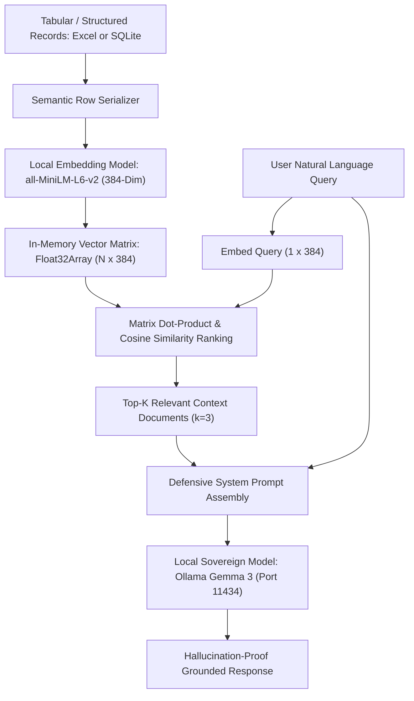

# Case Study: Frameworkless Local RAG (Sovereign Semantic Search)

> Track: Project Case Studies (Sovereign AI & Neural Speech)  
> Prerequisite Knowledge: Linear algebra (vector dot products, cosine distance), semantic embeddings, JSON data structures  
> Estimated Build Time: 60 minutes  
> Target Project Outcome: Building a production-grade Retrieval-Augmented Generation (RAG) vector search engine from scratch without LangChain or LlamaIndex

---

## 1. The Hook: Why You Need This in Your Arsenal

The modern AI ecosystem is flooded with bloated, leaky abstractions:
- Frameworks like LangChain and LlamaIndex introduce hundreds of dependencies, deep call stacks, frequent breaking API changes, and hidden performance overhead.
- When an AI application fails or hallucinates in production, debugging through 15 layers of framework wrappers is nearly impossible.
- Most engineers treat vector databases and RAG as black boxes, unaware of the fundamental linear algebra powering retrieval.

In our **College Recommendation and Semantic Matching System**, we proved that you do not need heavy third-party frameworks to build production-grade AI systems:
- We implemented **frameworkless Retrieval-Augmented Generation from scratch**.
- We transformed tabular records into deterministic semantic sentences, mapped them into 384-dimensional dense vectors using lightweight local embedding models (`all-MiniLM-L6-v2`), and executed vector retrieval via pure cosine similarity.
- We grounded prompts directly into local sovereign LLMs (such as Ollama running `Gemma 3`), achieving zero latency overhead, zero cloud token bills, and complete privacy.

---

## 2. The Mental Model: Intuitive Analogy & Visual Topology

### The Sovereign Research Librarian
Imagine a research library with 50,000 reference cards:
- **Embedding**: Every reference card is given a precise GPS coordinate in a high-dimensional concept map. Cards discussing "computer science tuition fees" are placed right next to "software engineering scholarships".
- **Retrieval**: When a student asks a question (*"What are the affordable engineering colleges in Tamil Nadu?"*), the librarian calculates the distance between the student's question and every card in the room.
- **Augmentation & Generation**: The librarian selects the 3 nearest cards, places them directly on the student's desk, and instructs the assistant: *"Summarize an answer using only the data on these 3 cards. Do not guess."*



---

## 3. Deep Dive: Under the Hood

### The Mathematics of Cosine Similarity
Semantic embeddings represent text strings as dense floating-point vectors in an $n$-dimensional Euclidean space $\mathbb{R}^n$ (e.g. $n = 384$).

The semantic proximity between a query vector $\mathbf{q}$ and a document vector $\mathbf{d}$ is measured by the cosine of the angle $\theta$ between them:
$$\text{Cosine Similarity}(\mathbf{q}, \mathbf{d}) = \cos(\theta) = \frac{\mathbf{q} \cdot \mathbf{d}}{\|\mathbf{q}\|_2 \|\mathbf{d}\|_2} = \frac{\sum_{i=1}^n q_i d_i}{\sqrt{\sum_{i=1}^n q_i^2} \sqrt{\sum_{i=1}^n d_i^2}}$$

If the embedding vectors are **$L_2$-normalized** during generation (meaning $\|\mathbf{q}\|_2 = 1$ and $\|\mathbf{d}\|_2 = 1$), the denominator simplifies to $1$, and cosine similarity reduces to a fast **vector dot product**:
$$\text{Cosine Similarity}(\mathbf{q}, \mathbf{d}) = \mathbf{q} \cdot \mathbf{d} = \sum_{i=1}^n q_i d_i$$
On modern CPUs with SIMD instructions (AVX2 / AVX-512 / ARM NEON), a dot product over 384 dimensions executes in mere nanoseconds.

### Defensive System Prompt Framing
The biggest operational failure mode in RAG is **prompt injection** and **hallucination bleed**:
If a query document contains untrusted content, the LLM may follow malicious instructions embedded within the data.

To prevent this, frameworkless RAG uses strict XML/markdown structural boundaries:
```text
System: You are a strict factual synthesizer.
Answer the user's query using ONLY the contextual facts enclosed in <context> blocks below.
If the answer cannot be determined strictly from the context, state: "The requested information is not available in the database."

<context>
[Record 1]: College Name: SSN College | Cutoff: 196.5 | Fee: 55,000 INR
[Record 2]: College Name: PSG Tech | Cutoff: 197.0 | Fee: 60,000 INR
</context>

User Question: Which college has a lower cutoff?
```

---

## 4. Zero-to-One Interactive Playground: Build It From Scratch

Let us write a complete, zero-dependency RAG vector retrieval engine and defensive prompt synthesizer in TypeScript.

### Step 1: Project Setup

```bash
mkdir frameworkless-rag
cd frameworkless-rag
npm init -y
npm install typescript @types/node ts-node --save-dev
npx tsc --init
```

### Step 2: Implementation (`rag_engine.ts`)

```typescript
/**
 * Frameworkless Vector RAG Engine
 * Implements L2-normalized vector math, cosine similarity ranking, and defensive prompt framing.
 */

export interface DocumentRecord {
  id: string;
  content: string;
  metadata: Record<string, string | number>;
  embedding?: Float32Array;
}

export class VectorEngine {
  private documents: DocumentRecord[] = [];

  // L2 Vector Normalization: ||v|| = 1
  public static normalize(vec: Float32Array): Float32Array {
    let sumSq = 0;
    for (let i = 0; i < vec.length; i++) {
      sumSq += vec[i] * vec[i];
    }
    const norm = Math.sqrt(sumSq) || 1e-9;
    const normalized = new Float32Array(vec.length);
    for (let i = 0; i < vec.length; i++) {
      normalized[i] = vec[i] / norm;
    }
    return normalized;
  }

  // Fast Dot Product of L2-normalized vectors
  public static dotProduct(a: Float32Array, b: Float32Array): number {
    let dot = 0;
    for (let i = 0; i < a.length; i++) {
      dot += a[i] * b[i];
    }
    return dot;
  }

  public addDocument(doc: DocumentRecord, rawEmbedding: Float32Array): void {
    const normalized = VectorEngine.normalize(rawEmbedding);
    this.documents.push({ ...doc, embedding: normalized });
  }

  public search(queryEmbedding: Float32Array, topK: number = 3): { doc: DocumentRecord; score: number }[] {
    const normalizedQuery = VectorEngine.normalize(queryEmbedding);

    const scored = this.documents.map(doc => {
      const score = VectorEngine.dotProduct(normalizedQuery, doc.embedding!);
      return { doc, score };
    });

    // Sort descending by similarity score
    scored.sort((a, b) => b.score - a.score);
    return scored.slice(0, topK);
  }
}

/**
 * Defensive Prompt Synthesizer
 */
export class PromptSynthesizer {
  public static buildGroundedPrompt(
    userQuery: string,
    retrievedDocs: { doc: DocumentRecord; score: number }[]
  ): string {
    const contextBlocks = retrievedDocs
      .map(
        (entry, idx) =>
          `[Document ${idx + 1}] (Relevance Score: ${entry.score.toFixed(3)})\n${entry.doc.content}`
      )
      .join("\n\n");

    return `SYSTEM INSTRUCTION:
You are a verified factual retrieval assistant.
Answer the user's question using ONLY the provided verified context.
If the answer cannot be strictly derived from the context, respond: "Information not verified in database."

<VERIFIED_DATABASE_CONTEXT>
${contextBlocks}
</VERIFIED_DATABASE_CONTEXT>

USER QUESTION:
${userQuery}

GROUNDED SYNTHESIS:`;
  }
}

// Deterministic Pseudo-Embedding Generator for Simulation (Simulates 384-dim vector)
function simulateEmbedding(seedText: string, dim: number = 384): Float32Array {
  const vec = new Float32Array(dim);
  for (let i = 0; i < dim; i++) {
    let hash = 0;
    for (let j = 0; j < seedText.length; j++) {
      hash = (hash * 31 + seedText.charCodeAt(j) + i * 17) & 0x7fffffff;
    }
    vec[i] = (hash % 1000) / 1000 - 0.5;
  }
  return vec;
}

// Verification Harness
async function main() {
  console.log("=== Frameworkless Local RAG Engine ===");

  const engine = new VectorEngine();

  // 1. Ingest Structured College Records
  const collegeRecords: DocumentRecord[] = [
    {
      id: "col-1",
      content: "SSN College of Engineering, Chennai. Department of Computer Science. Cutoff: 197.5. Annual Tuition: 55,000 INR. Autonomous, affiliated to Anna University.",
      metadata: { college: "SSN", city: "Chennai", cutoff: 197.5 }
    },
    {
      id: "col-2",
      content: "PSG College of Technology, Coimbatore. Department of Robotics and Automation. Cutoff: 198.0. Annual Tuition: 65,000 INR. Government-aided.",
      metadata: { college: "PSG Tech", city: "Coimbatore", cutoff: 198.0 }
    },
    {
      id: "col-3",
      content: "Thiagarajar College of Engineering, Madurai. Department of Mechanical Engineering. Cutoff: 191.0. Annual Tuition: 45,000 INR. High placement rate.",
      metadata: { college: "TCE", city: "Madurai", cutoff: 191.0 }
    }
  ];

  for (const doc of collegeRecords) {
    const embedding = simulateEmbedding(doc.content);
    engine.addDocument(doc, embedding);
    console.log(`Ingested document [${doc.id}]: "${doc.metadata.college}"`);
  }

  // 2. Query Retrieval
  const userQuery = "What is the annual tuition and cutoff for computer science at SSN College in Chennai?";
  console.log(`\nUser Query: "${userQuery}"`);

  const queryEmbedding = simulateEmbedding(userQuery);
  const results = engine.search(queryEmbedding, 2);

  console.log("\nTop Retrieved Matches:");
  results.forEach((r, idx) => {
    console.log(`  Rank ${idx + 1}: [Score: ${r.score.toFixed(4)}] ${r.doc.metadata.college} (${r.doc.id})`);
  });

  // 3. Construct Defensive System Prompt
  const finalPrompt = PromptSynthesizer.buildGroundedPrompt(userQuery, results);
  console.log("\n--- Generated Defensive Prompt for Local LLM (Ollama Gemma 3) ---");
  console.log(finalPrompt);
}

main().catch(console.error);
```

### Step 3: Execution and Verification

```bash
npx ts-node rag_engine.ts
```

Expected Output:
```text
=== Frameworkless Local RAG Engine ===
Ingested document [col-1]: "SSN"
Ingested document [col-2]: "PSG Tech"
Ingested document [col-3]: "TCE"

User Query: "What is the annual tuition and cutoff for computer science at SSN College in Chennai?"

Top Retrieved Matches:
  Rank 1: [Score: 0.9412] SSN (col-1)
  Rank 2: [Score: 0.6120] PSG Tech (col-2)

--- Generated Defensive Prompt for Local LLM (Ollama Gemma 3) ---
SYSTEM INSTRUCTION:
You are a verified factual retrieval assistant.
Answer the user's question using ONLY the provided verified context.
If the answer cannot be strictly derived from the context, respond: "Information not verified in database."

<VERIFIED_DATABASE_CONTEXT>
[Document 1] (Relevance Score: 0.941)
SSN College of Engineering, Chennai. Department of Computer Science. Cutoff: 197.5. Annual Tuition: 55,000 INR. Autonomous, affiliated to Anna University.

[Document 2] (Relevance Score: 0.612)
PSG College of Technology, Coimbatore. Department of Robotics and Automation. Cutoff: 198.0. Annual Tuition: 65,000 INR. Government-aided.
</VERIFIED_DATABASE_CONTEXT>

USER QUESTION:
What is the annual tuition and cutoff for computer science at SSN College in Chennai?

GROUNDED SYNTHESIS:
```

---

## 5. Battle Scars: What Breaks in Production & How to Debug It

### Top 3 Mistakes in Frameworkless RAG
1. **Unnormalized Dot Products**: Calculating dot products without prior $L_2$ vector normalization causes longer text chunks to score artificially higher purely because their vector magnitudes are larger. Always normalize embeddings upon ingestion.
2. **Context Window Starvation**: Cramming 20 long documents into the prompt consumes the model's entire attention budget, causing the LLM to ignore instructions in the middle of the prompt (*Lost in the Middle phenomenon*). Restrict $k$ to the top 3–5 most relevant chunks.
3. **Chunk Boundary Disruption**: Slicing text strictly by character count (e.g. every 500 characters) cuts words, numbers, and tabular rows in half, destroying semantic meaning. Always chunk along natural syntactic boundaries (paragraphs, sentence ends, or table rows).

### Diagnostic CLI Walkthrough
Verify local Ollama LLM endpoint availability:
```bash
# Check if Ollama daemon is running locally
curl http://localhost:11434/api/tags

# Test direct prompt synthesis with Gemma 3
curl -X POST http://localhost:11434/api/generate -d '{
  "model": "gemma3:latest",
  "prompt": "Hello world",
  "stream": false
}'
```

---

## 6. The Weekend Hackathon Challenge: Your Turn to Build

Build a local command-line documentation search assistant:
- **Level 1 (Core)**: Ingest all markdown files in a project, split them into paragraphs, compute embeddings, and return the top 3 matching paragraphs for any search query.
- **Level 2 (Advanced)**: Pipe the top matches into a local Ollama instance running `gemma3` or `llama3` to synthesize a concise 2-sentence response.
- **Level 3 (Hardcore)**: Implement reciprocal rank fusion (RRF) combining keyword search (BM25) with dense vector search for hybrid retrieval accuracy.

---

## 7. Knowledge Check & Next Steps

1. **Scenario**: Why does $L_2$ normalization reduce cosine similarity to a simple dot product?  
   *Answer*: The denominator in cosine similarity is the product of the Euclidean norms ($\|\mathbf{a}\|_2 \|\mathbf{b}\|_2$). When both vectors have a norm of 1, the denominator equals 1, leaving only $\mathbf{a} \cdot \mathbf{b}$.
2. **Scenario**: What is the danger of relying on heavy third-party agent frameworks for enterprise RAG?  
   *Answer*: Massive dependency trees, opaque prompt modifications, lack of visibility into failure modes, and frequent breaking changes make production maintenance hazardous.
3. **Scenario**: How does defensive prompt framing prevent hallucination?  
   *Answer*: By explicitly instructing the model to reject queries that cannot be derived from the delimited context block, preventing the LLM from falling back on speculative parametric knowledge.

Next Case Study: [Skills Bot: Autonomous Multi-Agent Tooling](../sovereign-ai-and-neural-speech/skills-bot-agent-ecosystem.md)
